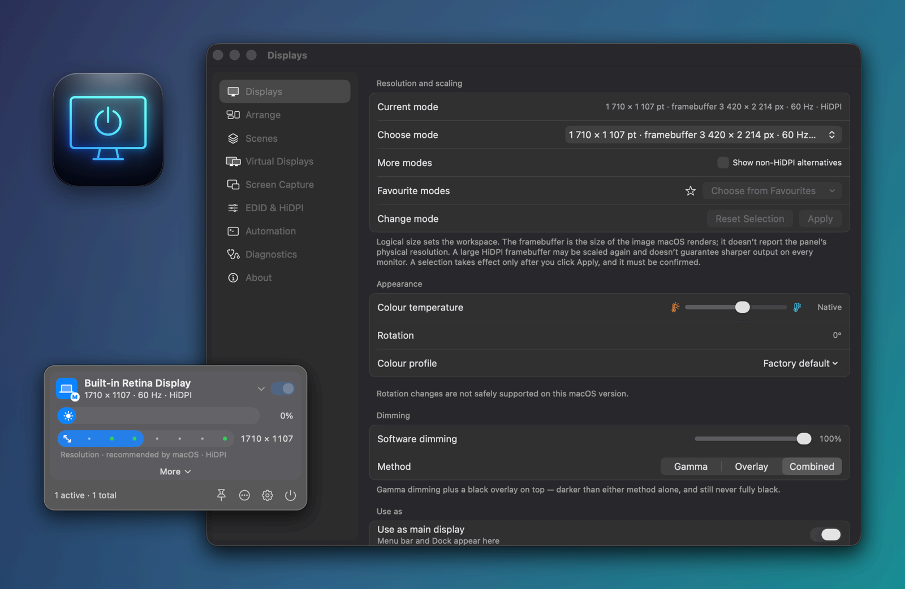
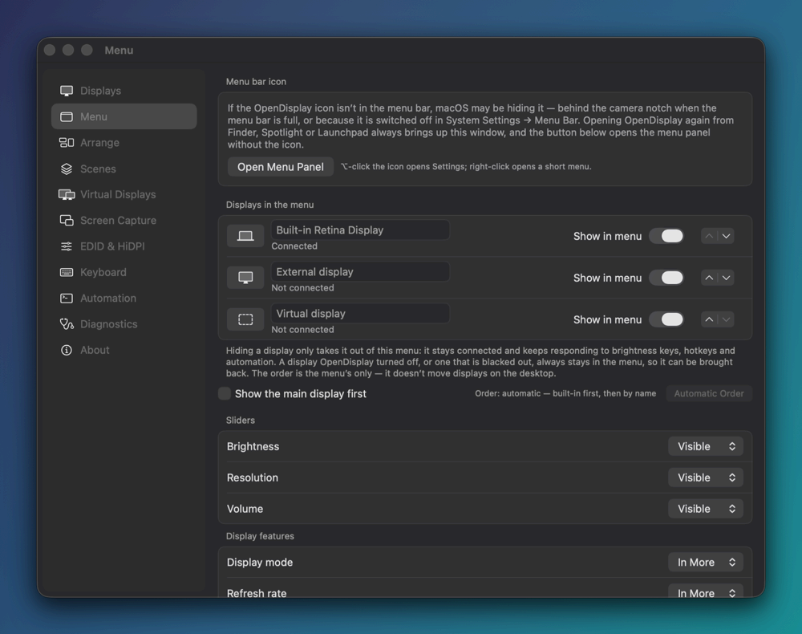
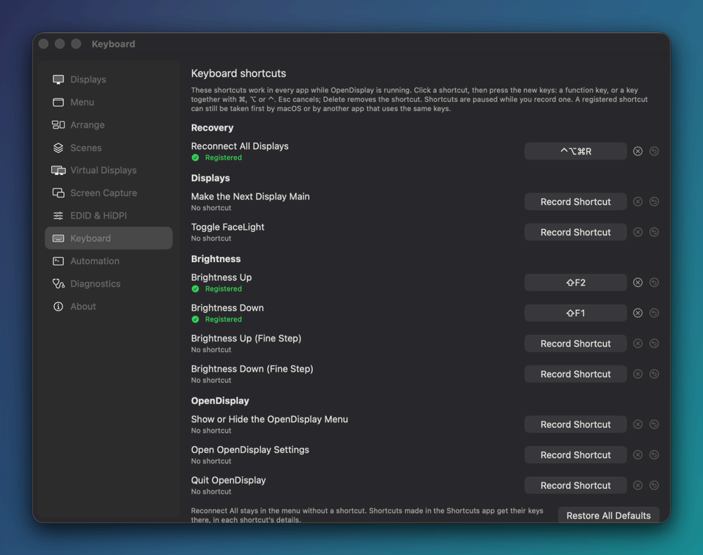
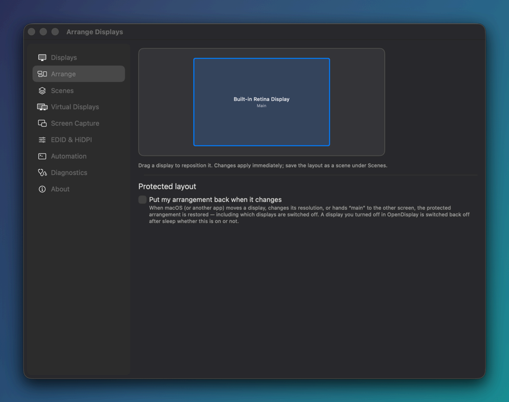
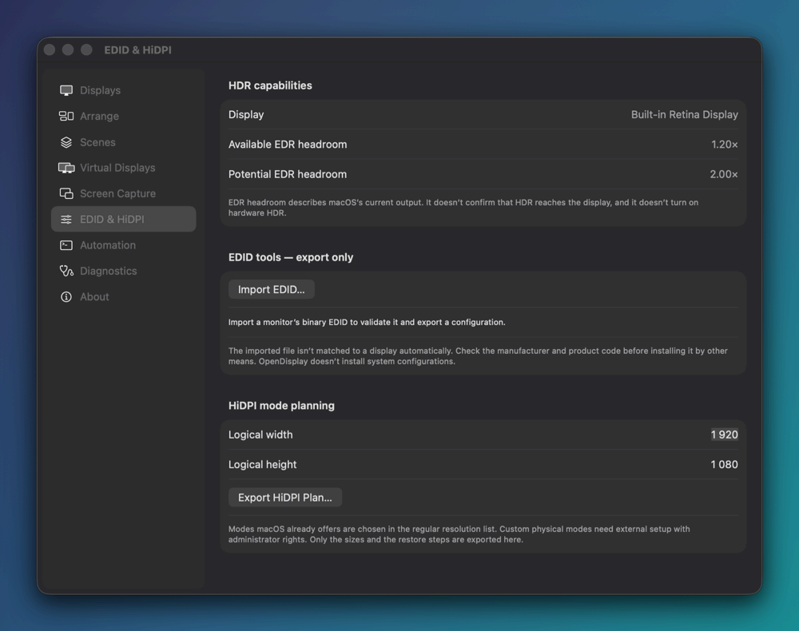
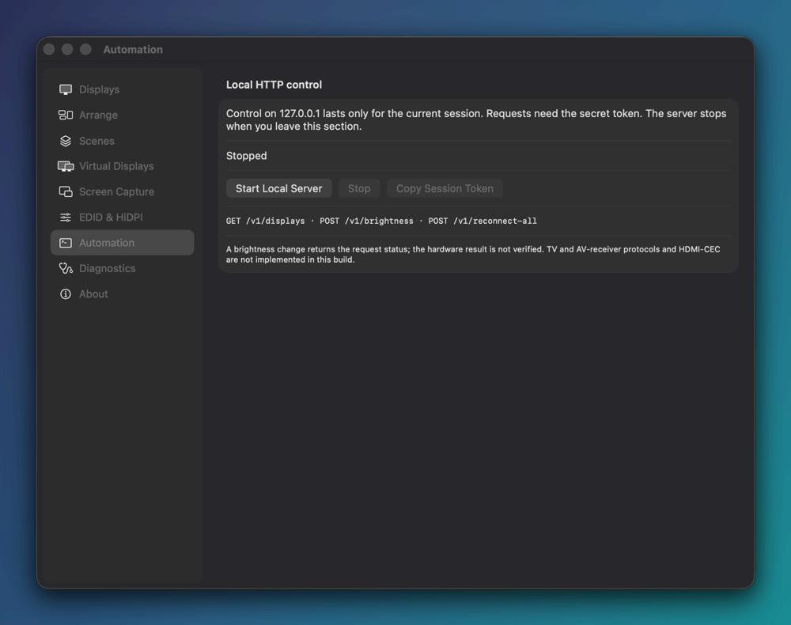
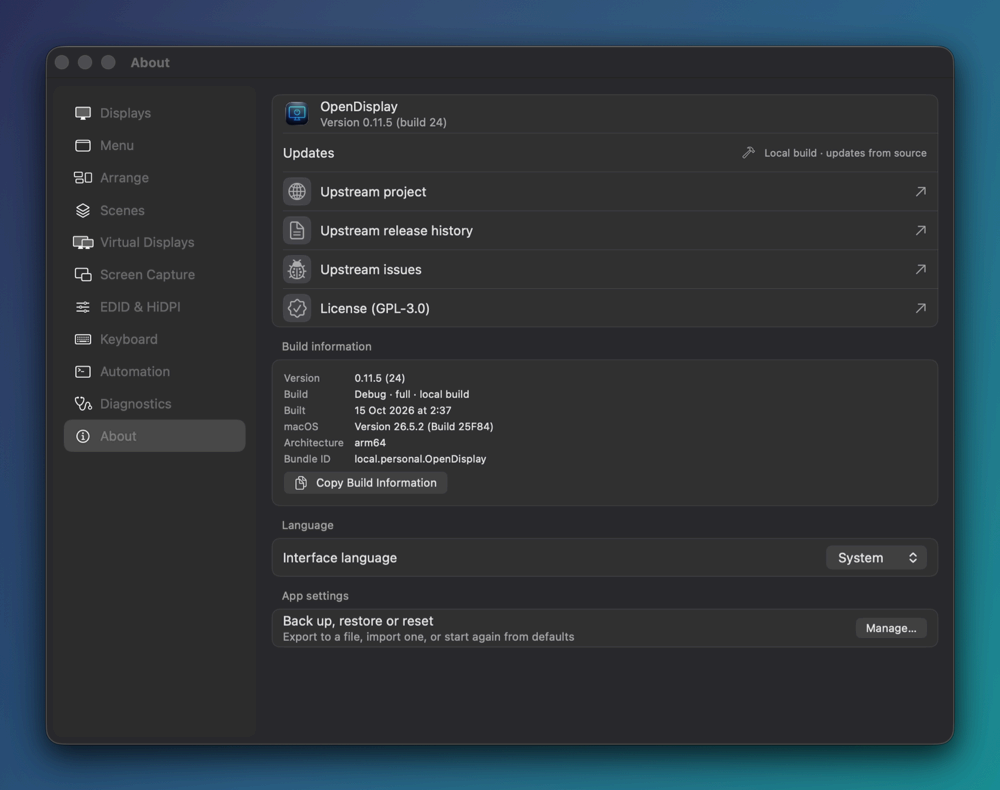
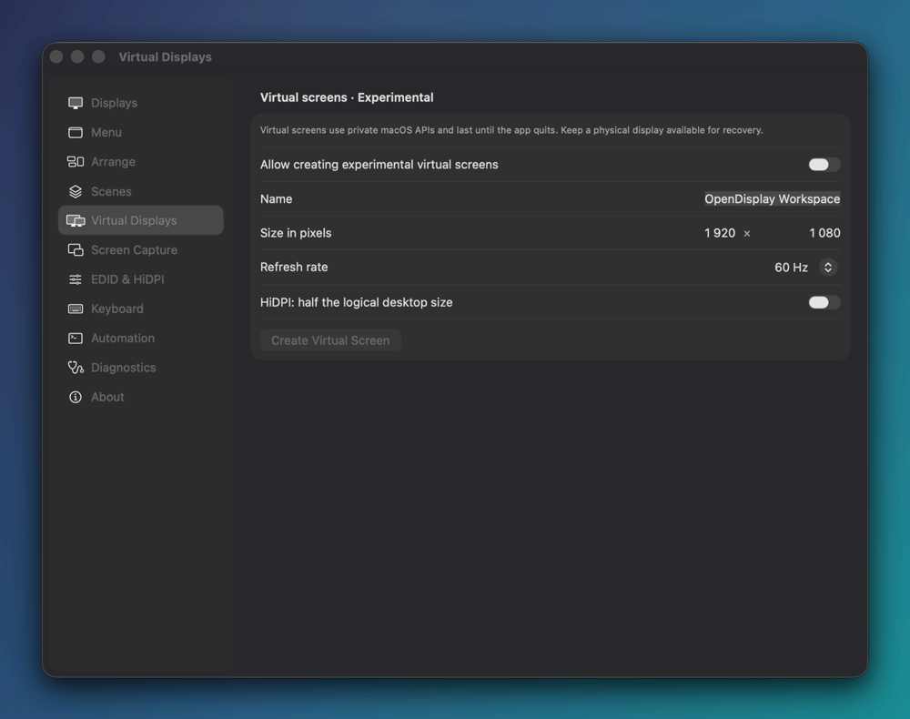
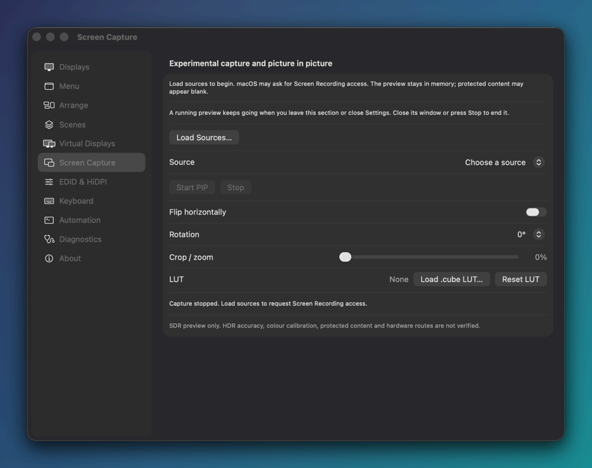

<p align="right"><b>English</b> · <a href="README.ru.md">Русский</a></p>

<p align="center">
  
</p>

<h1 align="center">FreeDisplay</h1>

<p align="center">
  <b>Free, open-source display control for Apple Silicon Macs.</b><br>
  Hardware brightness over DDC/CI, HiDPI modes, arrangement, scenes, virtual displays and automation,<br>
  all from the menu bar, with an interface in English and Russian.
</p>

<p align="center">
  <a href="LICENSE"></a>
  
  
  
  <a href="#interface-language"></a>
  
</p>

<p align="center">
  
</p>

<p align="center">
  <a href="#features">Features</a> ·
  <a href="#gallery">Gallery</a> ·
  <a href="#freedisplay-vs-betterdisplay">vs BetterDisplay</a> ·
  <a href="#interface-language">Language</a> ·
  <a href="#build-from-source">Build</a> ·
  <a href="#automation-examples">Automation</a> ·
  <a href="#project-structure">Structure</a> ·
  <a href="#license">License</a>
</p>

> [!NOTE]
> **Status: active development.** Tagged releases are built by GitHub Actions with ad-hoc signatures,
> without notarization. See [Install](#install) for downloads and first-launch instructions.

## What is FreeDisplay?

FreeDisplay is a fork of [**OpenDisplay**](https://github.com/aquitaine/OpenDisplay) by aquitaine,
a free GPL-3.0 menu-bar app that controls your monitors' real hardware and keeps your display setup
safe to change. FreeDisplay builds on OpenDisplay 0.11.5 and adds:

- a redesigned **menu-bar panel** you can arrange (which displays and controls it shows, in what
  order, with which icons) and a grouped Settings window;
- a **free-drag arrangement canvas** with snapping, in Settings and in the menu-bar panel;
- **software contrast** next to dimming and colour temperature, and a **Default display group**
  with absolute or delta brightness sync;
- an in-app **EDID reader and decoder** (CTA-861, DisplayID), per-display information reports and
  a complete, filterable mode list; EDID and HiDPI files are validated and exported, never installed;
- nine **Shortcuts actions**, native key and CoreAudio controls, a **command console**, a CLI
  that shares the running app’s state, and opt-in, token-protected **HTTP control**;
- **settings backup, import and reset**, a **safe startup** (hold Shift at launch) and a list of
  remembered identities with explicit settings transfer and manual DDC channel pairing through
  a user-run test;
- **virtual displays** for the current session (experimental);
- **screen capture with a picture-in-picture preview** (experimental);
- a full **Russian translation** with an in-app language switch;
- a **reliability pass**: fixes for Reconnect All, Black Out and display names, and for 30 of the 31
  most serious (P0) problems the guide study found in the code (see [Reliability](#reliability));
- a page-by-page [study of the BetterDisplay guide](Docs/BetterDisplay-Guide/) that tracks what is
  still missing.

**Not affiliated with BetterDisplay.** FreeDisplay is an independent project. It isn't affiliated
with, endorsed by or connected to BetterDisplay or its developer. "BetterDisplay" is a trademark of
its owner. The work is clean-room: BetterDisplay's public documentation is used only as a list of
*capabilities* to compare against. FreeDisplay contains no BetterDisplay code, assets, UI or text.

## Features

How to read the **Status** column:
**Core** is always available. Where the note says *full build*, the feature needs private macOS
APIs and is left out of the [public-API-only flavour](#public-api-only-flavour).
**Experimental** is opt-in, relies on private APIs or recent work, and may break with macOS updates.
**Labs** is off by default; it is marked *Labs* in *Settings → Diagnostics*, where you turn it on.

### Brightness & dimming

| Feature | What it does | Status |
|---|---|---|
| **Hardware brightness (DDC/CI)** | Sets the external monitor's real backlight, plus contrast, volume and mute, input source, the monitor's own colour preset, sharpness, RGB gain, power and factory reset. Settings are read back after a change, and the app says whether a write was confirmed, only sent, or failed. Standby and power-off ask for confirmation first. The CLI can read or write any raw MCCS VCP code. | Core · full build |
| **Built-in brightness** | Controls the built-in panel through the system brightness service. | Core · full build |
| **Software dimming, colour temperature, contrast** | Dims any display with gamma, a black overlay or both, including displays without DDC; by design it never goes fully black. Each display also gets colour temperature and **software contrast**: a tone curve in that display's colour table, not the monitor's own contrast. Dimming, temperature, contrast and the XDR boost are worked into one colour table. *Suspend* bypasses temperature and contrast without losing their values; *Reset* returns them and dimming to neutral. These adjustments last until you quit. A custom ICC profile pauses gamma-based adjustments unless you allow them. | Core |
| **Black Out** | Makes a display fully black with a click-through overlay. Offered only while another display stays lit. | Core |
| **XDR Brightness** | Pushes SDR content on a built-in XDR panel up to 2× its normal maximum using EDR headroom. Never survives quit or a crash. You can have it switch off on battery or in Low Power Mode. | Labs |
| **Adaptive & scheduled brightness** | Follows the built-in display or ambient light sensor, with evening warmth and per-app presets. **Clock Mode** adds independent recipes for explicitly selected displays: fixed or solar times, transitions, time zone, brightness method, Apply Now and an explicit brightness-only Restore. Wake can apply the current interval or pause until Resume; manual app changes hold until the next point. Competing group sync or app presets block a recipe with a reason. [Clock Mode](Docs/Clock-Mode.md). | Core; private sensor/native/DDC routes need the full build; *Adaptive display* and *App Presets* are Labs |
| **Display groups** | One slider or brightness key moves several displays together, in one of three modes: *learned offsets* (each display keeps the offset you taught it), *absolute* (every display takes the same percentage) or *delta* (every display moves by the same amount). Contrast sync is optional. The **Default group**, off by default, gives every connected display that isn't in a named group basic brightness sync. Hold **Shift** while dragging a brightness slider to change only that display. | Core |
| **FaceLight** | One press turns a display into a bright fill light for video calls. Press again to restore the previous settings. | Core |

### Resolutions & modes

| Feature | What it does | Status |
|---|---|---|
| **Mode picker** | Lists every mode macOS reports for a display, with logical size, framebuffer, refresh rate, HiDPI and tags such as native, default or scaled. Filter by aspect ratio, refresh rate, density and depth, optionally include modes macOS marks as not for desktop use, and see why a mode isn't listed. The menu-bar panel has a resolution slider that keeps the current refresh rate, density and depth. | Core |
| **Favourite modes** | Star modes and switch between them quickly. A favourite keeps the exact mode, so 59.94 Hz and 60 Hz stay different. Also available as `opendisplay favorite`. | Core |
| **Keep or revert** | A new mode or arrangement stays only if you confirm it. Otherwise it reverts automatically after a countdown. | Core |
| **Main display, mirroring, colour profiles** | Choose the main display, mirror the main display, and apply or reset ICC profiles through ColorSync. *Colour profile details* show where the active profile comes from, its class, colour space and file. You can import copies of profiles into your profiles folder, move your own profiles to the Trash (with undo), and open them in Finder or ColorSync Utility. | Core |
| **Rotation** | Rotates through an isolated helper with automatic rollback. Unavailable on macOS versions where it can't be done safely. | Labs |

### Arrangement & scenes

| Feature | What it does | Status |
|---|---|---|
| **Arrangement canvas** | Drag displays freely. A dropped display snaps to the nearest edge, centre or corner of another one (hold Shift to keep the exact spot along the edge); dropping it between two displays inserts it there, and gaps close by themselves. Drag the white menu-bar strip onto another display, or Control-click it, to make that display the main one. Each change applies at once and reverts unless you keep it. A compact copy of the canvas sits in the menu-bar panel under *Tools → Display arrangement*. | Core |
| **Protected layout** | When hotplug, sleep or another app changes your setup, puts back positions, modes, mirroring (with the exact mirror source), the main display and which displays are off. Each combination of displays keeps its own layout. | Core |
| **Scenes** | Saves the arrangement and modes of all displays so you can plan or apply them later from the app or the CLI. Applying a scene reports anything macOS didn't apply. | Core |
| **Logical disconnect** | Turns a display off without unplugging it, and always keeps at least one physical display active. Optionally turns the built-in panel off when an external display connects. | Experimental · full build |

### Menu bar & remembered displays

| Feature | What it does | Status |
|---|---|---|
| **Displays in the menu** | *Settings → Menu* shows or hides each display in the menu-bar panel, renames it, gives it an SF Symbols icon and sets the order (or keeps an automatic order, optionally with the main display first). A display the app turned off, or a blacked-out one, always stays in the menu. | Core |
| **Menu contents** | Every slider and display feature can be *Visible*, *In More* or *Hidden*, and each tool can be shown or hidden. Open sections can be remembered, and *Reset Menu Layout* puts everything back. | Core |
| **Hidden icon recovery** | If macOS hides the menu-bar icon (behind the camera notch, or switched off in System Settings), opening the app again brings up Settings, and **Open Menu Panel** shows the panel without the icon. | Core |
| **Remembered displays** | *Settings → Displays → Remembered* shows saved identities, dates and recognition evidence, including conflicts and earlier identifiers. Automatic, strict UUID and qualified vendor/model/serial strategies are available; ambiguous identity never borrows another display’s settings. Optional retention is off until you set a duration; recovery records are protected. Forget/Reset preview their scope. | Core |
| **Settings transfer & migration** | Preview selected categories before replacing a connected display’s settings and forgetting the offline source, including its unselected preferences. Migration fills missing values from earlier IDs; conflicting sources require a choice. Stale previews refuse. Failed saves attempt rollback and retain a recovery snapshot; this is not crash-atomic storage. Physical consents and authored rules are not silently retargeted. | Core · partial strategy/portability coverage |
| **Manual DDC channel pairing** | For indistinguishable monitors, choose a channel, enter a test brightness and duration, run the flash/restore, acknowledge the observed screen and confirm separately. Changed route evidence revokes the mapping; retest after cable swaps. A sent restore is not physical proof. | Core · full build; hardware unverified |

### Virtual displays · Experimental

Creates virtual screens for the current session through a private macOS API. You set the name,
pixel size, refresh rate (30, 60 or 120 Hz) and HiDPI. Up to four can exist at once, and they
disappear when the app quits. Creation must be allowed first, and it is refused in Safe Mode or
when no physical display is visible for recovery. *Full build only.*

### Screen capture & picture in picture · Experimental

Shows a live ScreenCaptureKit preview of any display or window in a floating, resizable window.
The preview can be flipped horizontally, rotated, cropped or zoomed, and passed through a `.cube`
LUT. It's an SDR preview at 30 fps, scaled to at most 1920 px, and it stays in memory: nothing is
recorded to disk. A running preview keeps going when you close Settings. macOS asks for Screen
Recording permission the first time you load sources.

### EDID & HiDPI tools · read and export only

- *Settings → EDID & HiDPI* reads the selected display's EDID inside the app. The bytes must carry
  that display's vendor, product code and serial number. If several EDIDs do (identical monitors
  without serial numbers) or none does, the app says *ambiguous* or *not found* instead of guessing.
- The decoder covers the base block, CTA-861 extensions (video and audio formats, HDR metadata,
  colorimetry and more) and DisplayID 1.x/2.x, including tiled displays. Checksum and structure
  problems are listed, not hidden.
- The bytes can be shown as a hex dump, hex, Base64 or a C array and copied. Export the original
  bytes as `.bin`, or an Apple display-override plist when the strict check passes. Imported EDID
  files are decoded the same way.
- *Settings → Displays → Information → Show Report…* builds a report for one display (identity,
  modes, capabilities, connection, EDID), also available as saved-only facts for offline records.
  Preview, Copy and UTF-8 export share identifier-redaction options; hiding serials or UUIDs omits
  EDID sections. Unknown values stay unknown.
- Plan HiDPI sizes and export a JSON plan that includes the restore steps, read each display's
  current and potential EDR headroom, or dump an EDID with `opendisplay edid <selector> --out edid.bin`.

FreeDisplay **never installs** overrides or system configuration. Applying an exported file is up
to you, and at your own risk.

### Refresh timing & luminance

| Feature | What it does | Status |
|---|---|---|
| **Refresh timing measurement** | Start/Stop measures OS display-link callback cadence for the selected display. Nominal refresh, the reported fixed/variable range and measured timing stay separate. A mode change restarts a running measurement. This does not measure physical panel or cable timing. | Core |
| **Luminance anchors** | Keeps EDID-reported and manually entered SDR/HDR anchors with their provenance. Overrides can be disabled without losing values or cleared. With usable SDR anchors, nits are a labelled linear estimate; unknown values stay unknown. No panel calibration, HDR enablement or nits-based group sync. | Core · partial luminance support |

### Automation

| Surface | What it does |
|---|---|
| **Shared command model** | CLI, app, console, HTTP, URL and App Intents use shared selectors, units, capabilities, validation and outcomes for admitted commands. Each surface has its own allowed commands. Hardware-only brightness refuses a software-only route; accepted, read-back and physical effects remain distinct. [Command model](Docs/Automation-command-model.md). |
| **CLI `opendisplay` & app IPC** | Typed commands use the running app’s live state through a same-user Unix socket. With the app off and the endpoint unavailable before sending, they use standalone providers and the persisted recovery ledger. Failed/uncertain IPC never retries standalone. Software brightness, atomic offsets, mode/main changes and ICC require the app. JSON objects expose `servedBy: app` or `standalone`; **`list --json` remains the legacy array**, without a wrapper. Unbridged legacy mutations refuse while the app runs; reads remain available. Exit codes stay 0/1/2/3. [Transport rules](Docs/Integration-transports.md). |
| **URL scheme** | `opendisplay://reconnect-all` runs recovery immediately. Other display mutations, including `disconnect`, are refused with an explanation. |
| **Shortcuts & Siri** | Nine App Intents: *Get/Set Display Brightness*, *Get/Set Display Mode*, *Get/Set/Reset Display Color Profile*, *Set Main Display* and *Reconnect All Displays*. Display selection and results are typed; a missing saved display never redirects. Set Brightness without a display targets the built-in panel. Mode/main changes use keep/revert; only **Set Display Mode** offers **Without confirmation**, **off by default**. Public-only builds support software brightness and public mode/ICC controls. *Settings → Automation* lists the actions and opens Shortcuts; installed action discovery still needs runtime acceptance. |
| **App-owned HTTP API** | Opt-in in *Settings → Automation*, off on a new install, loopback by default; it keeps running after Settings closes. The bearer token persists in Keychain and the selected port is reused (a blank port asks the OS once). Disable stops access; explicit token replacement revokes the saved credential. Separate remote access requires a warning confirmation; HTTP has no built-in TLS. Adds `GET /v1/commands` and `POST /v1/command` to the legacy display/brightness/recovery routes. Cached brightness has provenance/age or is unknown. |
| **Command console** | *Tools → Show Console…* runs shared named commands directly in the app, independently of HTTP. Quoting, history, draft restoration, help and separate output/log panes are supported; input never invokes a shell. Clear preserves history; exit closes the console. History/output/log capacities are configurable, with no default bound. [Console and diagnostics](Docs/Console-and-diagnostics.md). |
| **Structured actions, hooks & feeds** | *Settings → Actions & Hooks* defines typed commands, executable/script arguments, HTTP, app URLs and distributed notifications, with previews and parsed readback. New controllers, controls, hooks and polling start disabled; archive import pauses them. Seven lifecycle phases distinguish attempted disconnect from observed loss, sleep and wake. Caller-configured budgets/cadence and per-control queues apply. Feeds update state without a setter. There is no startup replay or automatic rollback of external effects. [Actions and hooks](Docs/Automation-actions-and-hooks.md). |
| **Native keys & audio** | Opt-in Accessibility capture has separate brightness/audio switches, conditions for taking over audio keys, F14/F15 mapping, fine steps, exclusions and native fallback. Targets include pointer, focused window and all eligible displays, with mirror expansion and endpoint deduplication; pointer/focus without a target never choose an unrelated screen. CoreAudio association uses actual names/UIDs and separate volume/mute capabilities, without changing the system playback output. DDC volume is probed at launch/connect; unqualified controls leave keys to macOS. Group audio sync and fullscreen-stream target integration remain absent. |
| **OSD & external feedback** | App-drawn styles, optional interactive slider, independent basic/custom feedback and per-display volume visibility. Choose affected/pointer/focus/primary screen and corner/menu-bar/icon placement. Opt-in receiver get/claim/release can restore prior preferences. Broadcasts work with the local HUD off; group followers publish `source=groupSync` without follower HUDs. Events distinguish requested/software-applied/read-back state; they do not acknowledge receiver delivery. Private system OSD styles and calibrated nits are absent. |
| **Keyboard shortcuts** | One recorder/registry exposes conflicts and registration failures, shared adjustment steps, recovery/display/input actions, brightness, software contrast/warmth/reset/suspend, CoreAudio volume/mute/unmute, menu, console, Settings, Quit and Restart. New action families start unbound. **⌃⌥⌘R** is reserved while recovery is enabled; recording pauses native dispatch. Carbon shortcuts need no Accessibility permission. Gamma exponent/inversion, HDR/upscaling, Night Shift/True Tone and keyboard-backlight actions remain unavailable. |
| **Notifications** | *Settings → Application* selects Notification Center, a FreeDisplay window or off, with separate routine-protection filtering and visible OS permission state. Notification preferences do not disable recovery or error handling. |

### Network TV control · partial

| Feature | What it does | Status |
|---|---|---|
| **LG webOS & Samsung TV** | Per-display manual pairing/reconnect, Keychain credentials, explicit endpoints and relative volume/mute/power-off. LG uses reported input IDs; Samsung source/HDMI actions are remote keys, not observed input state. Optional discovery gives untrusted address hints. TLS uses system trust or an explicitly verified per-device certificate fingerprint. Control is available in the app card/console, not CLI, HTTP, URL, Intents or hooks. | Core · partial; hardware unverified |
| **Wake-on-LAN** | Independent explicit MAC/destination/UDP configuration sends a wake request without requiring a paired session. Sent does not mean the TV woke. No independent wake probe, automatic sleep/wake power policy, delayed/repeated wake, native volume-key routing, signed/full LG manifest, absolute volume/picture controls or complete remote keypad. Philips, Yamaha and HDMI-CEC are absent. [TV guide](Docs/TV-control.md). | Core · partial; hardware unverified |

### App settings

| Feature | What it does |
|---|---|
| **Backup, import, reset** | *Settings → Application* exports preferences, menu layout, luminance anchors, Clock recipes, names, favourites, groups, presets, layouts, shortcuts, scenes and integration definitions. Import previews unmatched IDs without guessing replacements, backs up the destination and pauses imported integrations. Reset also backs up first; all backups are retained. HTTP/TV configuration, secrets, recovery debts and machine-local window/console state are outside portable archives. Review unmatched displays through explicit transfer/migration after relaunch. |
| **Safe startup** | Hold **Shift** at launch or use `--safe-mode`. Saved configuration stays intact while automatic layout/offline/built-in-off rules, adaptive/Clock/preset/group brightness, XDR power changes, keep-awake, retention, actions/hooks/polls and TV I/O are suppressed. HTTP stays paused for the session, including manual enable attempts. Explicit admitted commands and safety recovery remain available; crash mode/rotation rollback and last-screen protection still run. |
| **Dock icon** | *Settings → Application*: never, while Settings is open (default), while any app window is open, or always. Changing it does not restart capture; closing Settings keeps app-owned services alive. |
| **Keep displays awake** | Global external-display and per-display requests share one owned idle-display-sleep assertion. Only active verified physical screens hold it; the last owner leaving releases it. Unverified/virtual/headless screens cannot hold it. It does not prevent system, lid or manual sleep, and never removes another app’s assertions. |
| **Preferences & timing** | Application groups login/startup, window placement, motion, notifications and privacy. Settings remembers section, size and position with a reachable-screen fallback. Configuration/wake delays and animation duration distinguish automatic, explicit zero and invalid input; Reduce Motion disables animation. |
| **About & attribution** | Both About surfaces share selectable version/build/channel, copyable build information, FreeDisplay source/support/privacy/license links and separate aquitaine/OpenDisplay attribution. [Help](Docs/FreeDisplay-Help.md) and [operations/privacy](Docs/FreeDisplay-Operations.md) describe current scope. |

### Safety & recovery

| Feature | What it does |
|---|---|
| **Reconnect All** | Available from the menu, a global hotkey (**⌃⌥⌘R** by default), Shortcuts, the URL scheme, HTTP and `opendisplay recover`. |
| **Transactions & audit log** | Risky changes go through checkpoints, verification and rollback. Quitting the app reconnects every display it turned off, and keeps the record of any display that didn't come back. |
| **Rescue app** | The standalone **FreeDisplay Rescue** restores the last known-safe arrangement, even when the main app can't run. |
| **Diagnostics export** | Explicit local ZIP export includes app records, display configuration and recent logs, with a shared redaction policy for reports, settings and staged artifacts. Serial/UUID/registry removal defaults on; recognized credentials are always removed, opaque/unreadable material is omitted with a manifest. Sources stay untouched and nothing is uploaded. Redaction is not anonymization: review every file and omission report before sharing. |

If a display won't come back, see [Recovering a stranded display](Docs/Recovering-a-stranded-display.md).

### Reliability

Besides comparing features, the [BetterDisplay guide study](Docs/BetterDisplay-Guide/00-overview-and-backlog.md)
checked FreeDisplay's own code and grouped what it found into 31 P0 clusters, mostly places where the
app could act on the wrong display or report something it didn't know. Fixes for 30 of them are merged:

- **DDC:** standby and power-off need confirmation, and every DDC result says confirmed, sent or
  failed. A requested input isn't shown as current until the monitor reports it. When two monitors
  can't be told apart, DDC refuses instead of guessing, and Apple displays get no generic DDC unless
  you opt in per display.
- **Identity and EDID:** identical monitors no longer silently share one record or borrow each
  other's EDID; when they can't be told apart, the app says so.
- **Recovery:** only a physical screen counts as the one that must stay on, so a virtual screen
  can't stand in for it. A display that didn't reconnect when the app quit keeps its recovery record.
- **Modes and colour:** the resolution slider keeps the current refresh rate, density and depth;
  favourites keep exact modes; mirror restores use the exact source; colour-profile and gamma
  failures are shown; an unknown HDR state stays unknown.
- **Automation:** the CLI has strict options, real help and exit codes; HTTP brightness is labelled
  as a cached value with its age; brightness events are broadcast even when the HUD is off; a
  cleared shortcut stays cleared; the release script fails if signing or Gatekeeper checks fail.

Still open: **FD-015**. The DDC reader still accepts some replies without a length and checksum
check, because making it strict without hardware evidence could break monitors that work today.
The gap is documented in the code and waits for the maintainer's decision. All of these are code
fixes with unit tests; they haven't been checked on a wide range of real monitors.

## Gallery

<table>
  <tr>
    <td width="50%"><br><sub><b>Menu</b>: what the menu-bar panel shows, and in what order</sub></td>
    <td width="50%"><br><sub><b>Keyboard</b>: shortcut recorder with registration status</sub></td>
  </tr>
  <tr>
    <td width="50%"><br><sub><b>Arrange</b>: free-drag canvas and protected layout</sub></td>
    <td width="50%"><br><sub><b>EDID & HiDPI</b>: in-app EDID reader, read-only</sub></td>
  </tr>
  <tr>
    <td width="50%"><br><sub><b>Automation</b>: Shortcuts and local HTTP</sub></td>
    <td width="50%"><br><sub><b>About</b>: build info, language, settings backup</sub></td>
  </tr>
  <tr>
    <td width="50%"><br><sub><b>Virtual displays</b> (experimental)</sub></td>
    <td width="50%"><br><sub><b>Screen capture & PiP</b> (experimental)</sub></td>
  </tr>
</table>

## FreeDisplay vs BetterDisplay

BetterDisplay is a mature commercial app with a free tier and a paid Pro tier. FreeDisplay is
**not** a drop-in replacement. It covers the everyday core, and several large areas are still
missing. The page-by-page study of the official guide lives in
**[Docs/BetterDisplay-Guide/](Docs/BetterDisplay-Guide/)**: all 501 guide pages, with code evidence
for every topic. Its roadmap,
**[00-overview-and-backlog.md](Docs/BetterDisplay-Guide/00-overview-and-backlog.md)**, merges the
392 backlog items into 162 clusters: **31 P0 · 47 P1 · 62 P2 · 22 P3**. The status columns in that
file describe the code as of 14 October 2026, before the work listed here.

**Where the backlog stands on 15 October 2026:**

- **P0:** 30 of 31 clusters fixed; FD-015 (relaxed DDC checksum handling) remains open. See [Reliability](#reliability).
- **P1 waves 2–6 are integrated**, including their review fixes. This means implemented software paths and original guides, not complete guide parity or hardware certification. The roadmap’s older status cells are not a current completion count.
- **Wave 2:** native keyboard/CoreAudio targeting, capture policies, OSD placement/receiver handshake, shortcut recording, notifications, Dock and nine-action Shortcuts guidance. Partial: private system OSD, fullscreen-stream target integration, audio-group sync and richer DDC mute/relative-only controllers.
- **Wave 3:** explained remembered identities, previewed transfer/migration and manual DDC test pairing, refresh callback measurement, sourced luminance anchors, redacted reports, EDID inspection, settings archives and safe startup. Partial: the full identity strategy catalog, automatic cross-Mac remapping and crash-atomic multi-store recovery. Nits estimates are not calibration.
- **Wave 4:** shared typed commands, app IPC, nine App Intents, console, structured actions/hooks/feeds, unified diagnostic redaction and public image/CoreAudio/app shortcuts. Surface admission and app-off restrictions remain explicit; console/log capacities have no default bound. Unqualified system/HDR action families remain absent.
- **Wave 5:** app-owned opt-in HTTP, per-display Clock recipes, owned keep-awake, app preferences/timing, About attribution and help. Numeric timing parity defaults/maxima remain partial; remote HTTP needs separate transport protection.
- **Wave 6:** update lifecycle/release preparation and recording/Stream Deck guides exist; distribution acceptance is still pending. LG/Samsung manual network control and WOL are partial. Four native Stream Deck recipe actions work in code; PC/Mac Input still depend on P2 FD-089.

| Area | FreeDisplay today |
|---|---|
| DDC/CI hardware controls (Apple Silicon) | ✔ Brightness, contrast, volume, input, presets, RGB gain, power, raw VCP; readback and transport outcomes remain distinct |
| Software dimming, colour temperature and contrast | ✔ Per-display controls and public image shortcuts; gamma/ICC guards apply |
| Native keys, CoreAudio and OSD | Partial: UID/name association, pointer/focus/all targeting, capture policies and app-drawn OSD/receiver handshake; no group audio or fullscreen-stream target owner |
| Resolution/refresh picker, favourites, keep/revert | ✔ Offered exact modes, filters and OS callback timing measurement; no physical-link measurement |
| Arrangement, main display, layout protection, scenes | ✔ Canvas and keep/revert, including mirroring; relative layout rules remain P2 |
| Display groups | Partial: brightness/optional contrast and Default group; overlapping/directional/audio/nits sync remain P2 |
| Menu customisation | Partial: visibility/order/name/icon/item placement; detachable menu remains P2 |
| Remembered identities and settings | Partial: explanations, safe strategies, transfer/migration, test pairing and archives; no guessed cross-Mac remapping or crash-atomic store transaction |
| Safe startup, Dock, notifications, app preferences and keep-awake | ✔ Implemented public policy paths; timing/default-capacity parity and device acceptance remain separate |
| EDID read, decode, report and export | ✔ CTA-861/DisplayID, original bytes and redacted reports; override installation remains P2, EEPROM writing P3 |
| **Flexible HiDPI and custom resolutions** | ✘ Export-only plans; installers and generated ranges remain P2 |
| **XDR / HDR extra brightness and luminance** | Partial: built-in XDR Labs and sourced SDR/HDR anchors/SDR nits estimates; calibrated/external upscaling and nits sync remain P2 |
| **Link format, connection timing, VRR and HDR switching** | ✘ P2; software callback timing is a separate implemented reporter |
| **Streaming, multiple PiP, effects and persistent virtual screens** | Partial: session virtual screens and one SDR preview, with an external-recording guide; full workflows remain P2 |
| **Network TV and AV-receiver control** | Partial: manual LG/Samsung, relative keys/inputs/power-off and WOL; no automatic power/native volume keys/absolute picture controls/wake verification. Philips remains P2, Yamaha/service tools P3 |
| **HDMI-CEC and DisplayLink-specific control** | ✘ P2 |
| Automation | Partial breadth: shared engine, app IPC/standalone routes, nine Intents, durable HTTP, console, actions/hooks/feeds and per-display Clock recipes. URL remains recovery-only; broader lifecycle/input/effect adapters remain P2 |
| Releases and update notifications | Partial: ad-hoc GitHub Releases with SHA-256 and an in-app new-version notice; no notarization, no in-app install |
| Intel Macs | ✘ Apple Silicon only |

P3 also retains model-specific/expert adaptations, system/NVRAM reset, additional release channels
and optional extensions. Follow the [consolidated backlog](Docs/BetterDisplay-Guide/00-overview-and-backlog.md)
for IDs and dependencies. Builds and fake/unit tests do not establish real keyboard/TCC, installed
Shortcuts, socket/Keychain/LAN, TV, display/audio, sleep/wake, recorder or release acceptance.

Where FreeDisplay takes a different path:

- **Free and open source (GPL-3.0).** No licence key, no trial, no paid tier, and every line can be
  inspected.
- **Safety model.** Risky changes are transactions with verification and automatic rollback.
  Reconnect All is always one hotkey away, and a standalone rescue app is included.
- **Honest results.** When a monitor ignores a DDC write, the UI says so instead of showing a value
  the monitor isn't at. EDID reads, reports and the HTTP API say "unknown" or "ambiguous" rather
  than guess.

*The comparison reflects the public BetterDisplay guide as studied in October 2026. If something
here is wrong or out of date, please open an issue.*

## Interface language

<p align="center">
  
</p>

- By default the interface **follows your macOS language**. macOS picks the first language in your
  preferred list that the app supports (English or Russian) and falls back to English if neither
  is there. You can also set a per-app language in *System Settings → General → Language & Region →
  Applications*.
- To pin a language inside the app, open *Settings → Application → Interface language* and
  choose **System**, **English** or **Русский**. Click **Relaunch** to apply.
- The strings live in Xcode String Catalogs (`Apps/OpenDisplay/Resources/*.xcstrings`), with
  English as the source language. CLI output and JSON/HTTP field names stay in English, so scripts
  never depend on the UI language.

## Install

Requires an Apple Silicon Mac running macOS 14 or later.

1. Download `FreeDisplay.zip` and `FreeDisplay.zip.sha256` from
   [GitHub Releases](https://github.com/garshany/FreeDisplay/releases) once a release is published.
2. In the download directory, run `shasum -a 256 -c FreeDisplay.zip.sha256`, then unzip and move
   `FreeDisplay.app` to Applications.
3. On first launch, **right-click → Open**: releases are ad-hoc signed and are **not notarized**.
   macOS may also ask for approval in **System Settings → Privacy & Security**.

The app tells you when a new version is available; **Download** opens its GitHub Release page.
Quit the app and replace it manually. After replacement macOS may ask again for **Accessibility**
permission. SHA-256 checks integrity; it does not authenticate a Developer ID publisher.
For the standalone CLI, download `opendisplay.zip` and its checksum, verify it the same way, and
keep the binary together with its included frameworks. See [verification details](Docs/ReleaseVerification.md).

## Build from source

**Requirements:** an Apple Silicon Mac. Running the app needs macOS 14 or later; building needs
**Xcode 26** (tested with 26.6, Swift 6) and [XcodeGen](https://github.com/yonaskolb/XcodeGen)
(`brew install xcodegen`).

```sh
git clone https://github.com/garshany/FreeDisplay.git
cd FreeDisplay
make xcode                      # runs `xcodegen generate` (installs XcodeGen via Homebrew if missing)

xcodebuild -project OpenDisplay.xcodeproj -scheme OpenDisplay -configuration Debug \
  DEVELOPMENT_TEAM=<YOUR_TEAM_ID> CODE_SIGN_IDENTITY="Apple Development" CODE_SIGN_STYLE=Manual \
  build
```

- `OpenDisplay.xcodeproj` is generated and isn't committed. Re-run `make xcode` whenever
  `project.yml` changes.
- `project.yml` uses ad-hoc signing with no team. You can override it with your own stable identity
  as above or use an untracked local spec. macOS ties Accessibility permission to the signature.
- Other schemes: `OpenDisplayRescue` (rescue app), `opendisplay` (CLI) and
  `OpenDisplay-PublicAPIOnly`. `make bundle-helper` copies the CLI into
  `FreeDisplay.app/Contents/Helpers`, where the Labs rotation helper expects it. It builds with the
  signing settings from `project.yml`.
- The app lives in the menu bar. By default its Dock icon shows only while Settings is open
  (change it in *Settings → Diagnostics → Behavior*). ⌥-click the menu-bar icon to open Settings,
  and hold Shift while the app launches for a [safe startup](#app-settings).

### Tests

```sh
make test        # swift test --parallel
```

This runs the platform-independent core (`DisplayDomain`, `SceneEngine`, `AutomationSchema`,
`TopologyCore`): **2,038 unit and state-machine tests**, all passing on 15 October 2026, after a Codex review of the whole P1 diff and four follow-up fix rounds. The core
is meant to build on Linux too (`make bootstrap` installs a Swift 6 toolchain there). GitHub Actions
runs build, tests, all macOS schemes and synthetic loopback integration on push and pull request.

### Public-API-only flavour

`OpenDisplay-PublicAPIOnly` builds the same sources with `PUBLIC_API_ONLY` defined and without the
private-API providers. That removes DDC, built-in brightness, logical disconnect, rotation,
ambient-light and Night Shift readings, and virtual displays. Modes, arrangement,
scenes, software dimming, colour profiles, capture and the EDID tools remain, as do software-brightness
Clock recipes, CoreAudio controls and public-network TV adapters. Use it to audit the
app or where private APIs aren't acceptable.

### Releasing

Bump `MARKETING_VERSION` in `project.yml`, commit the reviewed change, create the matching `v1.0.0`
tag, and push that tag. GitHub Actions tests, builds, ad-hoc signs, packages and publishes the app
and CLI with SHA-256 files and generated release notes. No signing secrets are needed.
See [Docs/Releasing.md](Docs/Releasing.md) for the owner workflow and local packaging dry run.
Sparkle stays disabled; source builds keep the local-build label and may check GitHub for newer releases.

## Automation examples

<details>
<summary><b>CLI usage</b> (<code>opendisplay help</code>)</summary>

```text
opendisplay — FreeDisplay automation CLI

USAGE:
  opendisplay list [--json]
  opendisplay diagnose [--json]
  opendisplay diagnose --bundle [directory]   # diagnostics zip for a bug report (default: Desktop)
  opendisplay lux [--json]
  opendisplay lid [--json]
  opendisplay listen
  opendisplay alias <selector> <name>
  opendisplay tag <selector> <tag>
  opendisplay disconnect <selector> [--dry-run] [--json]
  opendisplay reconnect <selector> [--json]
  opendisplay recover [--json]                # reconnect every display OpenDisplay turned off
  opendisplay scene <list|save|show|plan|apply|delete> [name] [--json]
  opendisplay layout <protect|unprotect|status> [--json]
  opendisplay group <list|create|delete> [name] [--json]
  opendisplay group <add|remove> <name> <selector>
  opendisplay brightness <selector> [0..1|N%] [--method automatic|hardware|native|ddc|software] [--json]
  opendisplay brightness <selector> --offset <delta>  # atomic in the running app
  opendisplay mode <selector> [--json]       # exact available modes, current first
  opendisplay capabilities <selector> [--json]
  opendisplay commands [--json]             # typed command catalog
  opendisplay ready [--json]
  opendisplay contrast <selector> [0..1|N%] [--json]  # managed hardware contrast
  opendisplay main <selector> [--json]
  opendisplay profile <selector> [profile] [--json]
  opendisplay profiles [--json]
  opendisplay command <name> [parameter=value ...] [--json] [--dry-run]

Shared-model commands use the running FreeDisplay app, or standalone providers when it is off.
--timeout <seconds> is optional for IPC; without it no client deadline is imposed. Losing a
response never retries standalone. Legacy reads work while the app runs; legacy mutations
require it to be off. No command launches the app automatically.
  opendisplay ddc <selector> <brightness|contrast|volume|input|colour|sharpness|red|green|blue|mute|power|caps> [value] [--json]
  opendisplay ddc <selector> reset                # restore the monitor's factory defaults (VCP 0x04)
  opendisplay ddc <selector> vcp <0xNN> [value]   # any raw MCCS feature code
  opendisplay edid <selector> [--out <path.bin>]
  opendisplay favorite <list|set|unset> <selector> [WxH[@Hz][@2x]]
  opendisplay help | --help | -h

Options are accepted only by the commands listed with them; any other option is an error, so
for example `--dry-run` never silently performs a real write.

DIAGNOSTICS: --log-output off|stdout|stderr (default off); -v = stdout, -v2e = stderr.
stdout diagnostics are refused with --json or listen. Use stderr for machine-readable results.

RESULTS: a write is reported as `verified` only when reading the value back shows it; `sent`
means the display accepted the write but nothing confirmed it took. Failures go to stderr.

EXIT STATUS: 0 success (including nothing to do) · 1 failed · 2 usage error (nothing ran) ·
3 partly done (some displays/fields applied, others failed or were skipped).

lux/lid exit non-zero when the sensor/state is unavailable. listen streams line-delimited JSON
(one event per line) until Ctrl-C; see Tools/opendisplay/README.md for the event schema.

SELECTORS: id:<recordID> · alias:<name> · tag:<tag> · group:<name> · main · builtin · state:<active|managedOffline> · <cgDisplayID>

group:<name> matches every member of a display group. `brightness group:desk 0.6` sets the
group's base level and each member follows it at its own learned offset.
```

</details>

```sh
opendisplay list --json                   # legacy array, on both execution paths
opendisplay command listDisplays --json   # typed result, with servedBy: app|standalone
opendisplay ready --json                  # app readiness; false/exit 1 when it is off
opendisplay brightness id:RECORD '60%' --json
opendisplay brightness id:RECORD --offset '+5%' --json  # running app required
opendisplay contrast id:RECORD '70%' --json  # normalized hardware contrast
opendisplay mode id:RECORD --json          # available modes; mode changes require the app
opendisplay ddc id:RECORD vcp 0x60         # raw MCCS read (here: input source)
opendisplay recover --json                # app ledger via IPC, or persisted ledger standalone
opendisplay listen                        # JSON events, one per line, until Ctrl-C
```

Replace `RECORD` with a record ID from discovery. Shared-model command-result JSON objects add `servedBy`;
`list --json` keeps its legacy array and fields, with no provenance wrapper. Use
`command listDisplays --json` for the typed discovery result. Raw DDC writes, alias/tag edits,
scene mutations and other unbridged legacy writes require the app to be off. See the
[execution table](Tools/opendisplay/README.md#execution-table) for each form.

**Local HTTP API.** In *Settings → Automation*, enable local HTTP control, keep loopback selected,
note the bound port and use **Copy HTTP Token**. Closing Settings leaves the service running.
The token persists in Keychain; replace it explicitly with HTTP disabled to revoke old clients:

```sh
PORT=<port from the panel>
TOKEN="$(pbpaste)"
curl -s -H "Authorization: Bearer $TOKEN" "http://127.0.0.1:$PORT/v1/displays"
# {"displays":[{"active":true,"brightness":0.8,"brightnessAgeSeconds":42.5,"brightnessCachedAt":"…",
#   "brightnessSource":"appCache","id":"…","name":"…","physicalBrightnessVerified":false}]}
# A display the app has no level for yet: "brightness":null,"brightnessSource":"unknown"

curl -s -X POST -H "Authorization: Bearer $TOKEN" -H "Content-Type: application/json" \
     -d '{"displayId":"<id from /v1/displays>","value":0.5}' \
     "http://127.0.0.1:$PORT/v1/brightness"
```

A brightness response distinguishes acceptance and readback; `"physicalEffectVerified":false`
means neither is a physical luminance measurement. `GET /v1/commands` lists the shared HTTP catalog;
`POST /v1/command` accepts its named parameters. See [transport/security rules](Docs/Integration-transports.md)
and the [HTTP contract](Docs/Local-HTTP-Control.md).

**URL scheme:**

```sh
open "opendisplay://reconnect-all"
```

## Project structure

| Path | Contents |
|---|---|
| `Apps/OpenDisplay` | Menu-bar app and Settings window (SwiftUI + AppKit), String Catalogs |
| `Apps/OpenDisplayRescue` | Standalone rescue app that restores the last known-safe arrangement |
| `Packages/` | Platform-independent core, also built and tested by SwiftPM: `DisplayDomain`, `ProviderInterfaces`, `SceneEngine`, `AutomationSchema`, `TopologyCore`, `SimulatorProvider`. Plus the macOS-only `OpenDisplayDesignSystem` UI kit |
| `Providers/` | macOS back ends: `CoreGraphicsProvider` (public API), `ExperimentalLifecycleProvider` (DDC, disconnect, rotation, built-in brightness; private API), `VirtualDisplayProvider`, `CaptureProvider` |
| `Tools/opendisplay` | Automation CLI |
| `Docs/` | Architecture, recovery model, RFCs, HTTP API, EDID tools, [BetterDisplay guide study](Docs/BetterDisplay-Guide/) |
| `Tests/` | Integration harness (local HTTP loopback) and hardware-lab notes |
| `project.yml`, `Package.swift`, `Makefile` | XcodeGen spec, SwiftPM manifest, developer entry points |

<details>
<summary><b>More documentation</b></summary>

- [Architecture overview](Docs/Architecture/overview.md) · [Architecture decisions](Docs/Architecture/decisions.md)
- [Recovery model](Docs/Recovery/recovery.md) · [Recovering a stranded display](Docs/Recovering-a-stranded-display.md)
- [Local HTTP control](Docs/Local-HTTP-Control.md) · [Advanced display tools (EDID/HiDPI)](Docs/ADVANCED-DISPLAY-TOOLS.md)
- RFCs: [capture preview](Docs/RFCs/0010-opt-in-capture-preview.md) · [session virtual displays](Docs/RFCs/0042-session-virtual-displays.md)
- [BetterDisplay guide study](Docs/BetterDisplay-Guide/) · [consolidated backlog and P1 waves](Docs/BetterDisplay-Guide/00-overview-and-backlog.md)
- [Product requirements](Docs/PRD.md) · [Upstream changelog](CHANGELOG.md) (OpenDisplay history up to 0.11.5)

</details>

## Contributing

Issues and pull requests are welcome. Please read [CONTRIBUTING.md](CONTRIBUTING.md) (inherited
from upstream) first. Its two key rules:

- **Clean-room only.** No decompiled or reverse-engineered proprietary code, and no copied UI,
  icons, screenshots or text from other display apps.
- **Sign off** every commit (`git commit -s`, DCO).

For this fork, also run `make test` before sending a change, and check UI changes in both English
and Russian. New user-visible strings need a Russian translation in the String Catalog.

## Security

- The full build uses **private macOS APIs**: SkyLight for logical disconnect, IOAVService for DDC,
  DisplayServices for built-in brightness and CGVirtualDisplay for virtual screens. They are
  undocumented and can change with any macOS update. Experimental and Labs features are opt-in and
  reversible, and the [public-API-only flavour](#public-api-only-flavour) leaves them out entirely.
- HTTP is opt-in, app-owned and loopback by default, with a persistent Keychain bearer token and
  browser `Origin` rejection. Remote binding requires a separate warning confirmation; it is plaintext
  without a separately configured TLS tunnel. Disable HTTP to stop access, or replace its token to
  revoke clients. Same-user IPC has a separate UID/socket trust boundary. See [transports](Docs/Integration-transports.md).
- Permissions are requested only when you use the feature that needs them: Accessibility for the
  media keys, Screen Recording for capture, Notifications for display notices.
- Report/diagnostic exports remove selected identifiers by default and recognized credentials always.
  Portable settings backups can retain hardware IDs and sensitive configuration. Redaction is not
  anonymization; inspect the actual files before sharing.
- Please report vulnerabilities **privately**. Use GitHub's private vulnerability reporting on
  this repository if it's enabled, or contact the maintainer
  [@garshany](https://github.com/garshany). Don't open a public issue. See also
  [SECURITY.md](SECURITY.md) (inherited from upstream).

## License

FreeDisplay is licensed under the **GNU General Public License v3.0**, like upstream OpenDisplay
(GPL-3.0-or-later; see [LICENSE](LICENSE)). The copyright of the original OpenDisplay code stays
with its authors; FreeDisplay's changes are released under the same licence. If you distribute a
modified build, the GPL requires you to provide the corresponding source.

## Acknowledgements

- [**OpenDisplay**](https://github.com/aquitaine/OpenDisplay) by aquitaine and contributors: the
  foundation of this project, including the DDC engine, the safety model, the rescue app and the
  CLI.
- [Sparkle](https://sparkle-project.org) (linked by the app, disabled in this fork) and
  [XcodeGen](https://github.com/yonaskolb/XcodeGen).
- The public-domain NOAA solar equations behind Clock Mode and Location Mode.
- The authors of BetterDisplay, MonitorControl and Lunar, for showing what display control on
  macOS can be. FreeDisplay is independent of all of them.

## FreeDisplay help

Start with the [capability and troubleshooting guide](Docs/FreeDisplay-Help.md),
[privacy and deployment](Docs/FreeDisplay-Operations.md),
[independent recording workspace](Docs/FreeDisplay-Recording.md), and
[Shortcuts / Stream Deck recipe](Docs/FreeDisplay-Stream-Deck.md).
Release publishers use the [verification checklist](Docs/FreeDisplay-Release-Checks.md);
recipients use [download verification](Docs/ReleaseVerification.md).
