<p align="right"><a href="README.md">English</a> · <b>Русский</b></p>

<p align="center">
  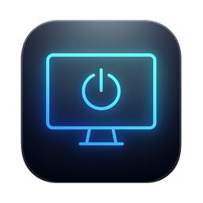
</p>

<h1 align="center">FreeDisplay</h1>

<p align="center">
  <b>Бесплатное приложение с открытым кодом для управления мониторами на Mac с Apple Silicon.</b><br>
  Аппаратная яркость по DDC/CI, режимы HiDPI, расположение экранов, сцены, виртуальные экраны и автоматизация<br>
  прямо из строки меню. Интерфейс на русском и английском.
</p>

<p align="center">
  <a href="LICENSE"></a>
  
  
  
  <a href="#язык-интерфейса"></a>
  
</p>

<p align="center">
  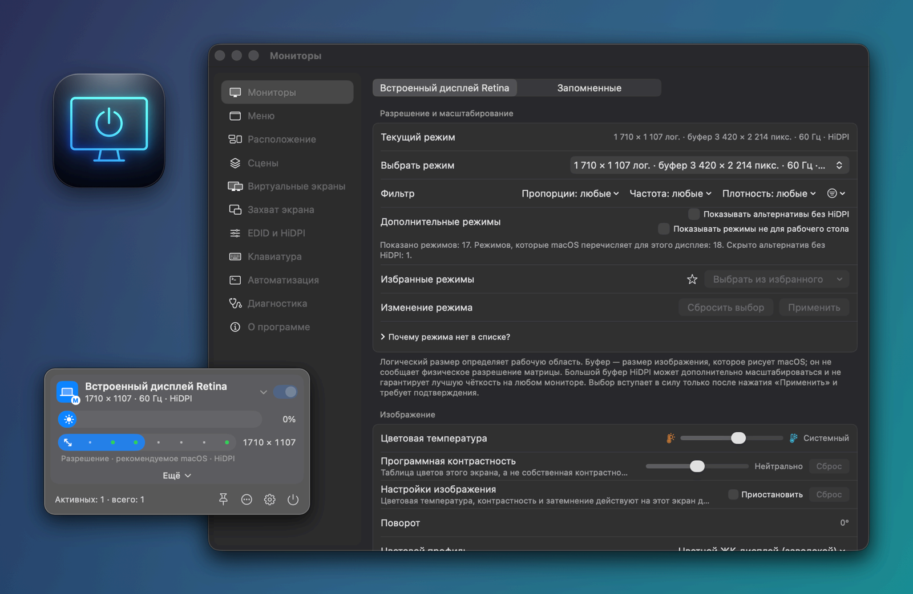
</p>

<p align="center">
  <a href="#возможности">Возможности</a> ·
  <a href="#галерея">Галерея</a> ·
  <a href="#freedisplay-и-betterdisplay">Сравнение с BetterDisplay</a> ·
  <a href="#язык-интерфейса">Язык</a> ·
  <a href="#сборка-из-исходников">Сборка</a> ·
  <a href="#примеры-автоматизации">Автоматизация</a> ·
  <a href="#структура-проекта">Структура</a> ·
  <a href="#лицензия">Лицензия</a>
</p>

> [!NOTE]
> **Статус: ранний закрытый форк, релизов нет.** FreeDisplay пока собирается только из исходников:
> подписанных и нотаризованных сборок нет, встроенное обновление в этом форке отключено.
> Приложение, утилита командной строки и URL-схема по-прежнему носят имя исходного проекта:
> **OpenDisplay.app**, `opendisplay`, `opendisplay://`.

## Что такое FreeDisplay

FreeDisplay — форк [**OpenDisplay**](https://github.com/aquitaine/OpenDisplay) (автор — aquitaine).
OpenDisplay — бесплатное приложение для строки меню под GPL-3.0: оно управляет «железом» мониторов
и следит, чтобы любые изменения конфигурации экранов можно было безопасно откатить. FreeDisplay
основан на OpenDisplay 0.11.5. Что в нём нового:

- переработанная **панель в строке меню**, которую можно настроить (какие экраны и элементы она
  показывает, в каком порядке и с какими значками), и окно настроек со сгруппированными разделами;
- **свободная схема расположения** экранов с выравниванием — в настройках и в панели строки меню;
- **программная контрастность** рядом с затемнением и цветовой температурой и **группа экранов
  по умолчанию** с абсолютной или разностной синхронизацией яркости;
- **чтение и расшифровка EDID** прямо в приложении (CTA-861, DisplayID), отчёт по каждому экрану
  и полный список режимов с фильтрами; файлы EDID и HiDPI проверяются и экспортируются, но не
  устанавливаются;
- **действия для «Команд»** с выбором дисплея, **запись сочетаний клавиш**, CLI с честными
  результатами и кодами выхода и **локальный HTTP API** для скриптов (только 127.0.0.1, доступ
  по токену);
- **резервная копия, импорт и сброс настроек**, **безопасный запуск** (Shift при запуске) и список
  запомненных экранов, которые можно забыть или сбросить;
- **виртуальные экраны** на время сеанса (экспериментально);
- **захват экрана с окном «картинка в картинке»** (экспериментально);
- полный **русский перевод** с переключением языка прямо в приложении;
- **работа над надёжностью**: исправления «Подключить все», «Затемнить полностью» и имён
  мониторов, а также 30 из 31 самых серьёзных (P0) проблем, найденных в коде при разборе
  руководства (см. [Надёжность](#надёжность));
- постраничный [разбор руководства BetterDisplay](Docs/BetterDisplay-Guide/) со списком того,
  чего ещё не хватает.

**FreeDisplay не связан с BetterDisplay.** Это независимый проект: он не аффилирован с BetterDisplay
и его разработчиком, не одобрен ими и никак с ними не связан. «BetterDisplay» — товарный знак его
владельца. Работа ведётся по принципу «чистой комнаты»: публичная документация BetterDisplay служит
только списком *возможностей* для сравнения. Кода, графики, интерфейса и текстов BetterDisplay
в FreeDisplay нет.

## Возможности

Как читать колонку **Статус**:
**Основная** — доступна всегда. Пометка *полная сборка* значит, что функции нужны закрытые API
macOS и в [вариант только с публичными API](#вариант-только-с-публичными-api) она не входит.
**Эксперимент** — включается по желанию, опирается на закрытые API или на свежий код и может
сломаться после обновления macOS.
**Labs** — выключено по умолчанию; такие функции помечены «Экспериментальные функции» в
*Настройки → Диагностика* и включаются там.

### Яркость и затемнение

| Функция | Что делает | Статус |
|---|---|---|
| **Аппаратная яркость (DDC/CI)** | Меняет настоящую подсветку внешнего монитора. Через DDC также доступны контрастность, громкость и выключение звука, источник сигнала, цветовой режим самого монитора, резкость, усиление RGB, питание и сброс к заводским настройкам. После изменения значение считывается обратно, и приложение сообщает, подтвердил ли монитор команду, была ли она только отправлена или не прошла. Перед переводом в режим ожидания и выключением монитора приложение просит подтверждения. Из командной строки можно читать и записывать любой код MCCS VCP. | Основная · полная сборка |
| **Яркость встроенного дисплея** | Управляет встроенной панелью через системную службу яркости. | Основная · полная сборка |
| **Программное затемнение, цветовая температура, контрастность** | Затемняет любой экран гаммой, чёрным слоем или обоими способами сразу, в том числе мониторы без DDC; полностью чёрным экран при этом не становится — так задумано. У каждого экрана есть ещё цветовая температура и **программная контрастность**: кривая тонов в таблице цветов этого экрана, а не собственная контрастность монитора. Затемнение, температура, контрастность и усиление XDR сводятся в одну таблицу цветов. *Приостановить* временно отключает температуру и контрастность, не теряя их значений; *Сброс* возвращает их и затемнение в нейтральное положение. Эти настройки действуют до выхода из приложения. Если назначен собственный ICC-профиль, настройки через гамму приостанавливаются, пока вы их явно не разрешите. | Основная |
| **Затемнить полностью** | Делает экран полностью чёрным с помощью слоя, пропускающего клики. Доступно, только пока горит другой экран. | Основная |
| **Яркость XDR** | Поднимает яркость SDR-содержимого на встроенной XDR-панели до 2× от обычного максимума за счёт запаса EDR. Само выключается при выходе из приложения или сбое; можно также настроить отключение при работе от батареи и в режиме энергосбережения. | Labs |
| **Адаптивная яркость и расписание** | Следует за встроенным дисплеем или датчиком освещённости. *Расписание яркости* задаётся по часам или относительно восхода, полудня и заката со смещением; есть режим по высоте солнца для вашего местоположения. Вечером цвета могут становиться теплее вслед за Night Shift, а для отдельных приложений можно завести свои профили. | Основная · полная сборка; *Адаптивное управление* и *Профили приложений* — Labs |
| **Группы экранов** | Один ползунок или клавиша яркости управляет сразу несколькими экранами в одном из трёх режимов: *выученные поправки* (каждый экран держит смещение, которому вы его научили), *абсолютный* (все экраны получают одинаковый процент) и *разностный* (все экраны сдвигаются на одну и ту же величину). Контрастность можно синхронизировать по желанию. **Группа по умолчанию** (по умолчанию выключена) даёт простую синхронизацию яркости всем подключённым экранам, которые не входят в именованные группы. Если двигать ползунок яркости с зажатым **Shift**, меняется только этот экран. | Основная |
| **Свет для камеры** | Одним нажатием превращает экран в яркую подсветку для видеозвонков; повторное нажатие возвращает прежние настройки. | Основная |

### Разрешения и режимы

| Функция | Что делает | Статус |
|---|---|---|
| **Выбор режима** | Показывает все режимы, которые macOS сообщает для экрана: логический размер, буфер, частоту обновления, HiDPI и метки вроде «родной», «по умолчанию» или «масштабированный». Список можно фильтровать по пропорциям, частоте, плотности и глубине цвета, по желанию показать режимы, которые macOS помечает как неподходящие для рабочего стола, и узнать, почему нужного режима нет в списке. В панели строки меню есть ползунок разрешения, который сохраняет текущие частоту, плотность и глубину цвета. | Основная |
| **Избранные режимы** | Отметьте режимы звёздочкой, чтобы быстро между ними переключаться. Избранное хранит режим точно, так что 59,94 и 60 Гц не смешиваются. То же доступно через `opendisplay favorite`. | Основная |
| **Оставить или вернуть** | Новый режим или расположение сохраняются, только если вы их подтвердите; иначе после обратного отсчёта всё вернётся само. | Основная |
| **Основной экран, дублирование, цветовые профили** | Выбор основного экрана, дублирование основного экрана, установка и сброс ICC-профилей через ColorSync. В *Сведениях о цветовом профиле* видно, откуда взят текущий профиль, его класс, цветовое пространство и файл. Профили можно импортировать (в папку профилей кладётся копия), свои профили — перемещать в Корзину с возможностью отмены и открывать в Finder или ColorSync-утилите. | Основная |
| **Поворот** | Работает через изолированный помощник с автоматическим откатом. В версиях macOS, где безопасный поворот невозможен, недоступен. | Labs |

### Расположение и сцены

| Функция | Что делает | Статус |
|---|---|---|
| **Схема расположения** | Экраны можно свободно перетаскивать. Отпущенный экран встаёт вплотную к другому, выравниваясь по ближайшему краю, центру или углу (с зажатым Shift он остаётся точно в том месте вдоль края); если отпустить его между двумя экранами, он встанет между ними, а образовавшиеся промежутки закроются сами. Чтобы сделать экран основным, перетащите на него белую строку меню или щёлкните по нему с Control. Каждое изменение применяется сразу и откатывается, если его не оставить. Компактная копия схемы есть в панели строки меню: *Инструменты → Расположение экранов*. | Основная |
| **Защищённое расположение** | Если подключение, сон или другое приложение сбили настройку, возвращает положение экранов, режимы, дублирование (с тем же источником, что был), основной экран и список выключенных экранов. Для каждого набора мониторов хранится своё расположение. | Основная |
| **Сцены** | Сохраняют расположение и режимы всех экранов, чтобы потом спланировать или применить их из приложения или командной строки. После применения сцены видно, что macOS не применила. | Основная |
| **Логическое отключение** | Выключает экран без отсоединения кабеля и всегда оставляет хотя бы один включённый физический экран. По желанию встроенный экран сам отключается при подключении внешнего монитора. | Эксперимент · полная сборка |

### Строка меню и запомненные экраны

| Функция | Что делает | Статус |
|---|---|---|
| **Экраны в меню** | В *Настройки → Меню* можно скрыть или показать каждый экран в панели строки меню, переименовать его, выбрать значок из SF Symbols и задать порядок (или оставить автоматический, по желанию с основным экраном первым). Экран, который выключило приложение, и полностью затемнённый экран всегда остаются в меню. | Основная |
| **Содержимое меню** | Каждый ползунок и функцию экрана можно сделать *На виду*, убрать *В «Ещё»* или скрыть; инструменты показываются или скрываются. Приложение может запоминать открытые разделы, а кнопка *Сбросить меню* возвращает всё как было. | Основная |
| **Если пропал значок** | Если macOS прячет значок в строке меню (за вырезом камеры или из-за настройки в «Системных настройках»), повторный запуск приложения открывает настройки, а кнопка **Открыть панель меню** показывает панель без значка. | Основная |
| **Запомненные экраны** | *Настройки → Мониторы → Запомненные* перечисляет все экраны, о которых приложение хранит записи. *Забыть* (для неподключённого экрана) и *Сбросить настройки* (для подключённого) заранее показывают, что именно будет удалено, и просят подтверждения. Забыть экран нельзя, пока его запись может понадобиться, чтобы вернуть его. | Основная |

### Виртуальные экраны · эксперимент

Создаёт виртуальные экраны на время сеанса через закрытый API macOS. Задаются имя, размер в
пикселях, частота (30, 60 или 120 Гц) и HiDPI. Одновременно может быть до четырёх экранов; при
выходе из приложения они исчезают. Создание сначала нужно разрешить. В безопасном режиме и без
видимого физического экрана для восстановления создать виртуальный экран нельзя. *Только полная сборка.*

### Захват экрана и «картинка в картинке» · эксперимент

Показывает живое изображение любого экрана или окна (через ScreenCaptureKit) в плавающем окне,
размер которого можно менять. Картинку можно отразить по горизонтали, повернуть, обрезать или
увеличить и пропустить через LUT в формате `.cube`. Это SDR-предпросмотр с частотой 30 кадров
в секунду и размером не больше 1920 пикселей. Он хранится только в памяти, на диск ничего не
пишется. Запущенный предпросмотр продолжает работать и после закрытия настроек. При первой
загрузке источников macOS попросит доступ к записи экрана.

### Инструменты EDID и HiDPI · только чтение и экспорт

- *Настройки → EDID и HiDPI* читают EDID выбранного экрана прямо в приложении. В байтах должны
  совпасть производитель, код модели и серийный номер этого экрана. Если таких EDID несколько
  (одинаковые мониторы без серийных номеров) или ни одного, приложение так и пишет — «неоднозначно»
  или «не найден» — и не гадает.
- Расшифровываются базовый блок, расширения CTA-861 (форматы видео и звука, метаданные HDR,
  колориметрия и другое) и DisplayID 1.x/2.x, включая составные (tiled) мониторы. Ошибки
  контрольных сумм и структуры показываются, а не скрываются.
- Байты можно посмотреть шестнадцатеричным дампом, в hex, Base64 или массивом C и скопировать.
  Исходные байты экспортируются в `.bin`, а plist переопределения дисплея Apple — только если
  прошла строгая проверка. Импортированные файлы EDID расшифровываются так же.
- *Настройки → Мониторы → Информация → Показать отчёт…* собирает отчёт по одному экрану
  (идентификация, режимы, возможности, подключение, EDID), который можно скопировать или сохранить
  текстом в UTF-8. Неизвестные значения так и остаются неизвестными.
- Можно спланировать размеры HiDPI и экспортировать план в JSON вместе с шагами отката, посмотреть
  текущий и потенциальный запас EDR каждого экрана или выгрузить EDID командой
  `opendisplay edid <селектор> --out edid.bin`.

FreeDisplay **ничего не устанавливает** в систему: ни переопределения, ни системные конфигурации.
Применять экспортированные файлы или нет — решать вам, и под вашу ответственность.

### Автоматизация

| Интерфейс | Что делает |
|---|---|
| **CLI `opendisplay`** | Список экранов, яркость, DDC (включая сырые коды VCP), сцены, защита расположения, группы, избранные режимы, EDID, датчик освещённости (`lux`), состояние крышки, диагностика и восстановление. Команда `listen` выдаёт поток событий в JSON, по одному на строку. Запись считается `verified`, только если обратное чтение показало то же значение, иначе — `sent`. Коды выхода: 0 — успех, 1 — ошибка, 2 — ошибка в командной строке (ничего не выполнялось), 3 — выполнено частично. Неизвестные параметры — ошибка, а не молча пропущенный флаг. |
| **URL-схема** | `opendisplay://reconnect-all` выполняется сразу. Ссылка `disconnect` отклоняется с понятным объяснением: ссылки никогда не меняют экраны. |
| **Команды и Siri** | Действия с выбором дисплея: *Узнать* и *Установить яркость дисплея* (0–100 %; в результате указано, подтвердил ли дисплей уровень), *Установить режим дисплея* (точные режимы дисплея; изменение нужно подтвердить, как при выборе в меню), *Выбрать основной дисплей*, а также *Подключить все дисплеи*. Если сохранённый в команде дисплей не подключён, команда сообщает об этом и не подставляет другой. Результаты типизированы, и команда может ветвиться по ним. *Настройки → Автоматизация* открывает «Команды». |
| **Локальный HTTP API** | Слушает только 127.0.0.1 на случайном порту; в каждом сеансе — новый 256-битный токен. Методы: `GET /v1/displays`, `POST /v1/brightness`, `POST /v1/reconnect-all`. Список экранов отдаёт последнюю известную приложению яркость вместе с её возрастом или `null`, если она неизвестна. Сервер работает, только пока открыт раздел *Настройки → Автоматизация*. |
| **Клавиши и экранный индикатор** | Клавиши яркости управляют выбранным экраном, аппаратно или программно. Клавиши громкости приложение перехватывает, только если громкость монитора по DDC уже удалось прочитать; иначе они остаются за macOS. Выключение звука использует собственную функцию монитора, если она есть, а если нет — это громкость 0, и так и подписано. У экранного индикатора несколько стилей; любое изменение яркости и громкости можно транслировать внешним приложениям-индикаторам. Нужно разрешение «Универсальный доступ». |
| **Сочетания клавиш** | В *Настройки → Клавиатура* можно записать глобальное сочетание для каждого действия: «Подключить все», сделать основным следующий дисплей, FaceLight, яркость больше и меньше (обычным и малым шагом), показать меню, открыть настройки, выйти из приложения. В каждой строке видно, зарегистрировала ли macOS сочетание, а если нет — почему (оно уже занято другим действием или macOS его отклонила). Сочетание можно удалить или вернуть стандартное. Там же задаются шаги регулировки, общие для клавиш яркости и громкости и для сочетаний. Сочетания ⌃⌥⌘ + цифра переключают монитор на нужный вход — удобно с KVM. |
| **Уведомления** | Уведомления о подключении и отключении экранов, автоматическом выключении встроенного экрана, защите расположения и сбоях. В *Настройки → Диагностика → Поведение* можно выбрать Центр уведомлений, окно OpenDisplay или отключить их, приглушить обычные уведомления защиты и увидеть, что сейчас разрешает macOS. |

### Настройки приложения

| Функция | Что делает |
|---|---|
| **Резервная копия, импорт, сброс** | *Настройки → О программе → Настройки приложения → Управление…* сохраняет в JSON-файл параметры, имена экранов, избранные режимы, группы, профили приложений, защищённые расположения, сочетания клавиш и сцены. При импорте файл проверяется, и вы видите сводку, в том числе экраны, которых этот Mac не знает. Перед импортом и сбросом к настройкам по умолчанию текущие настройки сохраняются в резервную копию, после чего приложение перезапускается. |
| **Безопасный запуск** | Удерживайте **Shift** при запуске приложения или запустите его с `--safe-mode`. В этом сеансе приложение ничего не меняет само: не восстанавливает расположение, не отключает экраны, не включает адаптивную яркость и расписание, профили приложений и синхронизацию групп. Настройки не меняются, а баннер перечисляет, что именно приостановлено. |
| **Значок в Dock** | *Настройки → Диагностика → Поведение*: никогда, пока открыты настройки (по умолчанию), пока открыто любое окно приложения или всегда. Значок в строке меню остаётся в любом случае. |
| **Окно настроек, сведения о сборке** | Настройки открываются на последнем разделе и с прежним размером окна. В разделе «О программе» есть сведения о сборке и кнопка **Скопировать сведения о сборке**. |

### Безопасность и восстановление

| Функция | Что делает |
|---|---|
| **Подключить все** | Доступно из меню, по глобальному сочетанию (по умолчанию **⌃⌥⌘R**), из «Команд», по URL-схеме, через HTTP и командой `opendisplay recover`. |
| **Транзакции и журнал** | Рискованные изменения проходят через контрольные точки, проверку и откат. При выходе приложение снова подключает все экраны, которые оно выключило, и сохраняет запись о тех, что не вернулись. |
| **Приложение для восстановления** | Отдельное приложение **OpenDisplay Rescue** возвращает последнее безопасное расположение, даже если основное приложение не запускается. |
| **Экспорт диагностики** | Сохраняет на рабочий стол один zip-архив с записями приложения, конфигурацией экранов macOS и свежими строками системного журнала про мониторы. Никуда не отправляется. |

Если монитор не возвращается, см. [Recovering a stranded display](Docs/Recovering-a-stranded-display.md)
(на английском).

### Надёжность

Помимо сравнения возможностей, [разбор руководства BetterDisplay](Docs/BetterDisplay-Guide/00-overview-and-backlog.md)
проверил и код самого FreeDisplay и свёл найденное в 31 кластер приоритета P0 — в основном места, где
приложение могло изменить не тот экран или сообщить то, чего не знало. Исправления для 30
из них уже влиты:

- **DDC:** режим ожидания и выключение монитора требуют подтверждения, а по каждой команде DDC
  видно, подтверждена она, только отправлена или не прошла. Запрошенный вход не отмечается
  текущим, пока монитор сам его не сообщит. Если два монитора невозможно различить, DDC отказывается
  работать, а не угадывает; к дисплеям Apple обычный DDC не применяется, пока вы не включите его
  для конкретного дисплея.
- **Идентификация и EDID:** одинаковые мониторы больше не получают молча одну общую запись или
  чужой EDID: если их нельзя различить, приложение так и сообщает.
- **Восстановление:** экраном, который обязан остаться включённым, считается только физический
  экран — виртуальный его не заменит. Экран, который не вернулся при выходе из приложения,
  сохраняет запись для восстановления.
- **Режимы и цвет:** ползунок разрешения сохраняет текущие частоту, плотность и глубину цвета;
  избранное хранит режимы точно; дублирование восстанавливается с тем же источником; ошибки
  цветовых профилей и гаммы показываются; неизвестное состояние HDR остаётся неизвестным.
- **Автоматизация:** у CLI строгие параметры, настоящая справка и коды выхода; яркость в HTTP
  помечена как значение из кэша с указанием возраста; события яркости транслируются, даже когда
  экранный индикатор выключен; удалённое сочетание клавиш не возвращается само; скрипт выпуска
  останавливается, если не прошли проверки подписи или Gatekeeper.

Пока не исправлено: **FD-015**. Чтение DDC по-прежнему принимает часть ответов без проверки длины
и контрольной суммы: если сделать проверку строгой без данных с реального оборудования, можно
сломать мониторы, которые сейчас работают. Это описано в коде и ждёт решения сопровождающего. Всё
перечисленное — исправления в коде с модульными тестами; на широком наборе реальных мониторов они
не проверялись.

## Галерея

<table>
  <tr>
    <td width="50%">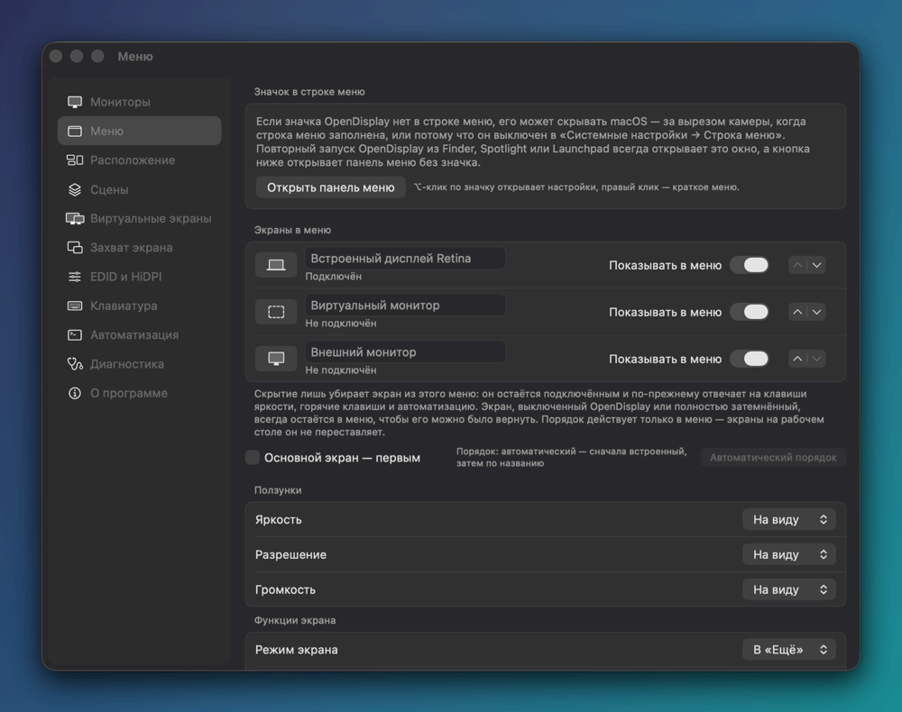<br><sub><b>Меню</b>: что и в каком порядке показывает панель</sub></td>
    <td width="50%">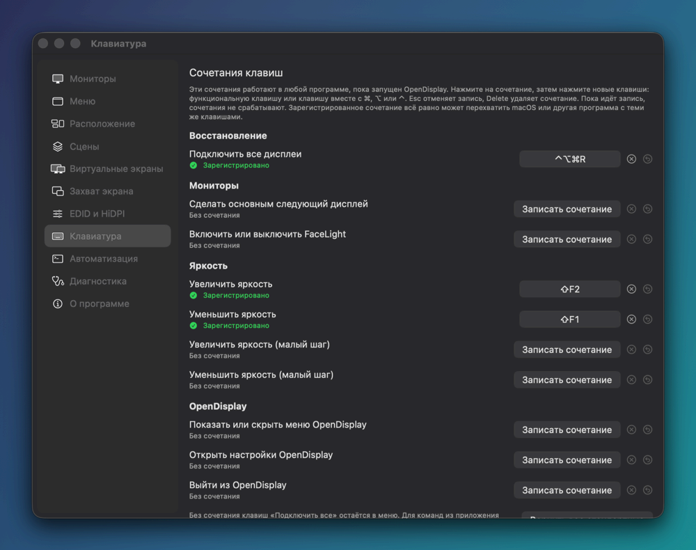<br><sub><b>Клавиатура</b>: запись сочетаний и их статус</sub></td>
  </tr>
  <tr>
    <td width="50%">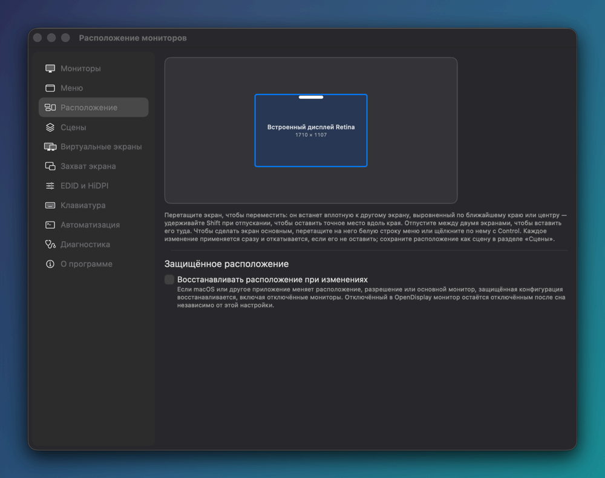<br><sub><b>Расположение</b>: свободная схема и защита</sub></td>
    <td width="50%">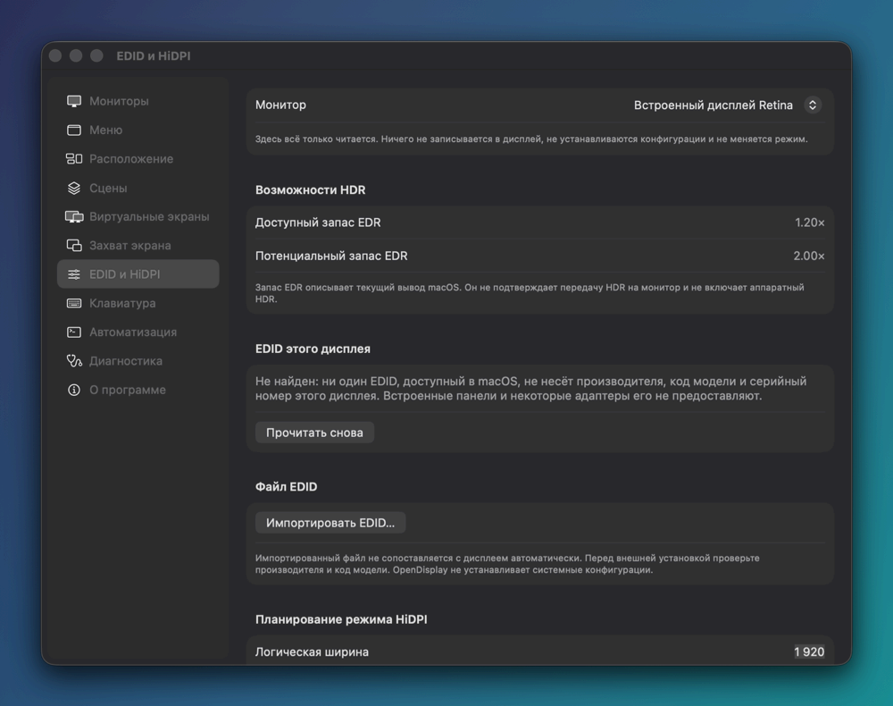<br><sub><b>EDID и HiDPI</b>: чтение EDID в приложении</sub></td>
  </tr>
  <tr>
    <td width="50%">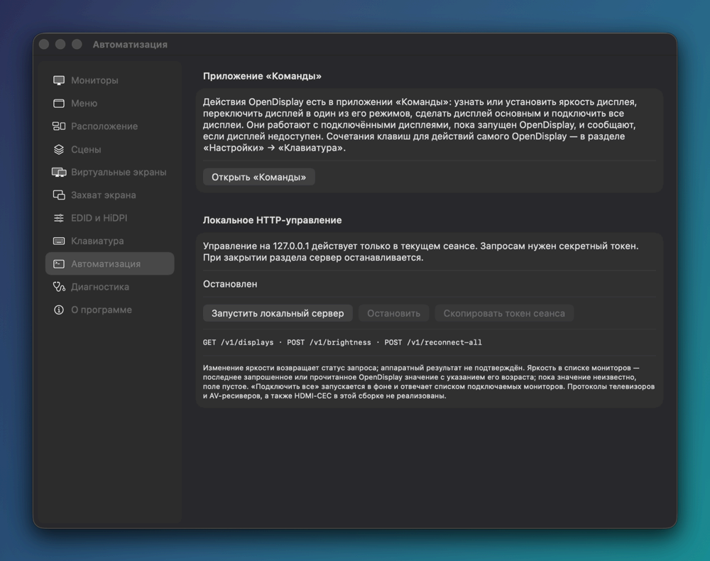<br><sub><b>Автоматизация</b>: «Команды» и локальный HTTP</sub></td>
    <td width="50%">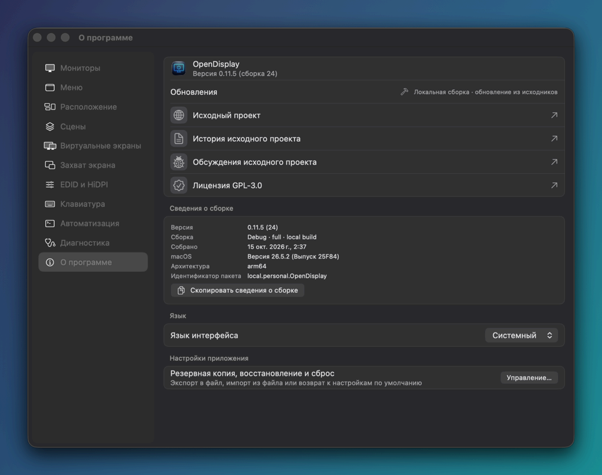<br><sub><b>О программе</b>: сборка, язык, резервная копия</sub></td>
  </tr>
  <tr>
    <td width="50%">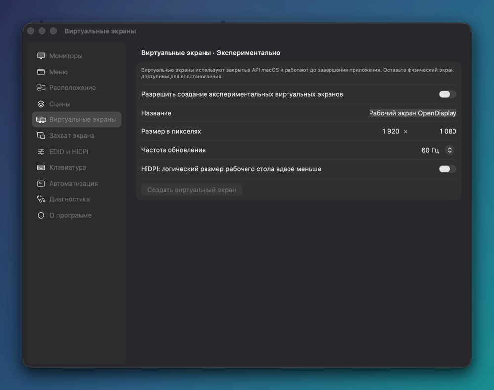<br><sub><b>Виртуальные экраны</b> (эксперимент)</sub></td>
    <td width="50%">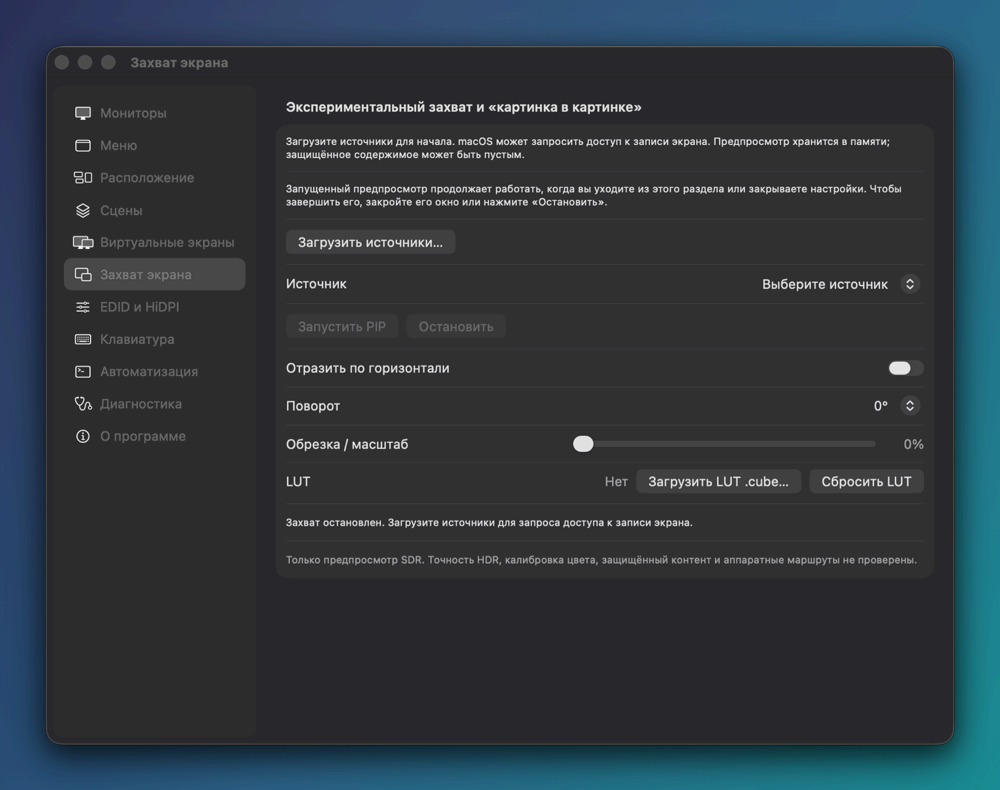<br><sub><b>Захват экрана и PiP</b> (эксперимент)</sub></td>
  </tr>
</table>

## FreeDisplay и BetterDisplay

BetterDisplay — зрелое коммерческое приложение с бесплатной и платной (Pro) версиями. FreeDisplay
**не** заменяет его один к одному: повседневный минимум закрыт, но нескольких крупных областей пока
нет. Постраничный разбор официального руководства лежит в
**[Docs/BetterDisplay-Guide/](Docs/BetterDisplay-Guide/)** (на английском): разобраны все
501 страница, по каждой теме приведены доказательства по коду. Сводный план,
**[00-overview-and-backlog.md](Docs/BetterDisplay-Guide/00-overview-and-backlog.md)**, объединяет
392 пункта бэклога в 162 кластера: **31 P0 · 47 P1 · 62 P2 · 22 P3**. Статусы в этом файле
описывают код на 14 октября 2026 года, то есть до работы, перечисленной ниже.

**Состояние бэклога на 15 октября 2026 года:**

- **P0 (исправления): исправлено 30 кластеров из 31.** Открытым остаётся FD-015 (нестрогая
  проверка ответов DDC), см. [Надёжность](#надёжность).
- **P1: влита работа по 22 кластерам из 47**, часть из них закрыта не полностью.
  - *Волна 1, повседневное управление экранами:* все 10 кластеров (список режимов и фильтры, шаги
    регулировки, схема расположения, цветовые профили, программная контрастность и возврат
    настроек изображения, настройка меню, группа по умолчанию). Не полностью: шаги пока не
    привязываются к делениям и не учитывают прокрутку, физический размер нельзя исправить вручную.
  - *Волна 2, клавиатура, звук и отклик:* 4 из 8 (запись сочетаний, уведомления, значок в Dock,
    подсказки для «Команд»). Нет: привязки к аудиоустройствам, наборов целей и режимов перехвата
    клавиш, настройки положения экранного индикатора.
  - *Волна 3, идентификация, диагностика и восстановление:* 5 из 8 (запомненные экраны, отчёт об
    экране, чтение EDID, резервная копия настроек, безопасный запуск). Нет: переноса настроек между
    идентичностями экранов, измеренной частоты обновления, опорных значений яркости в нитах.
  - *Волна 4, общая автоматизация:* 1 из 9 (сущность дисплея и действия для «Команд», пока без
    действия для цветового профиля) и часть другого кластера — сочетания для меню, настроек и выхода.
    Нет: единой типизированной модели команд для CLI, URL и HTTP, консоли команд, исходящих
    действий, обработчиков событий, единого журнала.
  - *Волна 5:* 2 из 6 (память окна настроек, сведения о сборке). *Волна 6* (собственные
    подписанные обновления FreeDisplay, руководство по записи экрана, управление телевизорами LG
    и Samsung) ещё не начата.

| Область | FreeDisplay сейчас |
|---|---|
| Аппаратное управление по DDC/CI (Apple Silicon) | ✔ Яркость, контрастность, громкость, вход, цветовые режимы, усиление RGB, питание, сырые коды VCP; результат — «подтверждено», «отправлено» или «не прошло» |
| Программное затемнение, цветовая температура, программная контрастность, медиаклавиши, экранный индикатор | ✔ |
| Выбор разрешения и частоты, избранное, «оставить или вернуть» | ✔ Полный список с фильтрами; только режимы, которые уже предлагает macOS |
| Расположение, основной экран, защита расположения, сцены | ✔ Свободная схема с выравниванием; без относительных правил расположения |
| Группы экранов | Частично: яркость по выученным поправкам, абсолютная или разностная, контрастность по желанию, группа по умолчанию; экран входит только в одну группу, направленной синхронизации нет |
| Настройка меню | Частично: видимость, порядок, имя и значок каждого экрана, размещение пунктов; меню нельзя открепить |
| Настройки приложения: резервная копия, импорт, сброс, значок в Dock, уведомления, безопасный запуск | ✔ |
| Чтение, расшифровка и экспорт EDID | ✔ В приложении, с расшифровкой CTA-861 и DisplayID |
| **Установка переопределений EDID** | ✘ Только проверка и экспорт |
| **Гибкое масштабирование HiDPI и свои разрешения** | ✘ Планировщик HiDPI только экспортирует план и ничего не устанавливает |
| **Дополнительная яркость XDR / HDR** | Частично: только встроенная XDR-панель (Labs); сторонние HDR-мониторы и калибровка в нитах не поддерживаются |
| **Формат подключения (RGB/YCbCr, диапазон, глубина), тайминги, VRR, включение HDR** | ✘ |
| **Трансляция, PiP на другой экран, окна видеофильтров, LUT на весь экран** | Частично: одно плавающее окно SDR-предпросмотра |
| **Управление телевизорами и AV-ресиверами по сети** (LG webOS, Samsung, Philips, Yamaha) | ✘ |
| **HDMI-CEC, DisplayLink** | ✘ |
| Виртуальные экраны | Частично: только на сеанс, базовые настройки, без привязок и HDR |
| Привязка к аудиоустройствам | Частично: сопоставление по имени, без системной привязки |
| Автоматизация | Частично: CLI с типизированными результатами, 5 действий для «Команд», 3 метода HTTP (только пока открыт раздел *Настройки → Автоматизация*), 1 команда URL; нет консоли, исходящих действий и обработчиков событий для отдельных экранов |
| Подписанные релизы и обновления | ✘ Только сборка из исходников |
| Mac на Intel | ✘ Только Apple Silicon |

В чём FreeDisplay идёт своим путём:

- **Бесплатно и с открытым кодом (GPL-3.0).** Ни ключей, ни пробного периода, ни платной версии;
  каждую строку можно проверить.
- **Модель безопасности.** Рискованные изменения выполняются как транзакции с проверкой и
  автоматическим откатом. «Подключить все» всегда на расстоянии одного сочетания клавиш, а для
  крайнего случая есть отдельное приложение для восстановления.
- **Честные результаты.** Если монитор проигнорировал команду DDC, интерфейс так и скажет, а не
  покажет значение, которого на мониторе нет. Чтение EDID, отчёты и HTTP API пишут «неизвестно»
  или «неоднозначно», а не угадывают.

*Сравнение составлено по публичному руководству BetterDisplay в октябре 2026 года. Если что-то
здесь неверно или устарело, откройте issue.*

## Язык интерфейса

<p align="center">
  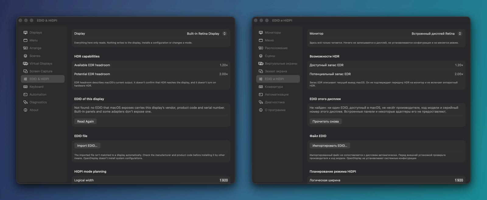
</p>

- По умолчанию интерфейс **следует языку macOS**: система берёт первый язык из вашего списка
  предпочтительных, который поддерживает приложение (английский или русский), а если ни одного нет —
  английский. Язык для отдельного приложения можно задать и в системных настройках, в разделе
  «Язык и регион».
- Чтобы закрепить язык в самом приложении, откройте *Настройки → О программе → Язык → Язык
  интерфейса* и выберите **Системный**, **English** или **Русский**. Изменение вступает в силу после
  кнопки **Перезапустить**.
- Строки хранятся в каталогах строк Xcode (`Apps/OpenDisplay/Resources/*.xcstrings`), исходный
  язык — английский. Вывод CLI и имена полей JSON/HTTP всегда на английском, поэтому скрипты не
  зависят от языка интерфейса.

## Сборка из исходников

**Что нужно:** Mac с Apple Silicon. Для запуска — macOS 14 или новее, для сборки — **Xcode 26**
(проверено на 26.6, Swift 6) и [XcodeGen](https://github.com/yonaskolb/XcodeGen)
(`brew install xcodegen`).

```sh
git clone https://github.com/garshany/FreeDisplay.git
cd FreeDisplay
make xcode                      # запускает `xcodegen generate` (при необходимости ставит XcodeGen через Homebrew)

xcodebuild -project OpenDisplay.xcodeproj -scheme OpenDisplay -configuration Debug \
  DEVELOPMENT_TEAM=<ВАШ_TEAM_ID> CODE_SIGN_IDENTITY="Apple Development" CODE_SIGN_STYLE=Manual \
  build
```

- `OpenDisplay.xcodeproj` генерируется и в репозиторий не входит. После изменений в `project.yml`
  запустите `make xcode` ещё раз.
- В `project.yml` приложение подписывается командой Developer ID исходного проекта, поэтому укажите
  свою команду, как в примере выше. Постоянная подпись важна: к ней macOS привязывает разрешение
  универсального доступа, без которого не работают медиаклавиши.
- Другие схемы: `OpenDisplayRescue` (приложение для восстановления), `opendisplay` (CLI) и
  `OpenDisplay-PublicAPIOnly`. `make bundle-helper` кладёт CLI в `OpenDisplay.app/Contents/Helpers`,
  где его ждёт помощник поворота из Labs. Эта команда собирает с настройками подписи из
  `project.yml`.
- Приложение живёт в строке меню. По умолчанию его значок в Dock появляется, только пока открыты
  настройки (это меняется в *Настройки → Диагностика → Поведение*). Настройки открываются ⌥-кликом
  по значку в строке меню, а Shift при запуске включает [безопасный запуск](#настройки-приложения).

### Тесты

```sh
make test        # swift test --parallel
```

Тесты покрывают платформенно-независимое ядро (`DisplayDomain`, `SceneEngine`, `AutomationSchema`,
`TopologyCore`): **1161 модульный тест и тест конечных автоматов** (на 15 октября 2026 года все
проходят). Ядро рассчитано и на сборку под Linux (`make bootstrap` ставит там Swift 6). Удалённого
CI нет — проверкой служит локальный прогон тестов.

### Вариант только с публичными API

`OpenDisplay-PublicAPIOnly` собирается из тех же исходников с флагом `PUBLIC_API_ONLY` и без
провайдеров на закрытых API. В нём нет DDC, яркости встроенного дисплея, логического отключения,
поворота, данных датчика освещённости и Night Shift, расписания яркости и виртуальных экранов.
Остаются режимы, расположение, сцены, программное затемнение, цветовые профили, захват экрана и
инструменты EDID. Этот вариант подходит для аудита и для мест, где закрытые API недопустимы.

### Релизы и обновления

**Релизов FreeDisplay пока нет.** Ключ `OpenDisplayLocalBuild` в Info.plist отключает обновление
через Sparkle, поэтому сборка FreeDisplay никогда не заменит себя релизом исходного OpenDisplay.
В разделе «О программе» написано «Локальная сборка · обновление из исходников». Чтобы обновиться,
заберите свежие изменения и пересоберите приложение. Homebrew cask и релизы исходного проекта
устанавливают **OpenDisplay**, а не FreeDisplay.

## Примеры автоматизации

<details>
<summary><b>Справка CLI</b> (<code>opendisplay help</code>, вывод на английском)</summary>

```text
opendisplay — OpenDisplay automation CLI

USAGE:
  opendisplay list [--json]
  opendisplay diagnose [--json]
  opendisplay diagnose --bundle [directory]   # diagnostics zip for a bug report (default: Desktop)
  opendisplay lux [--json]
  opendisplay lid [--json]
  opendisplay listen
  opendisplay alias <selector> <name>
  opendisplay tag <selector> <tag>
  opendisplay disconnect <selector> [--dry-run] [--json]
  opendisplay reconnect <selector> [--json]
  opendisplay recover [--json]                # reconnect every display OpenDisplay turned off
  opendisplay scene <list|save|show|plan|apply|delete> [name] [--json]
  opendisplay layout <protect|unprotect|status> [--json]
  opendisplay group <list|create|delete> [name] [--json]
  opendisplay group <add|remove> <name> <selector>
  opendisplay brightness <selector> [0..1] [--json]
  opendisplay ddc <selector> <brightness|contrast|volume|input|colour|sharpness|red|green|blue|mute|power|caps> [value] [--json]
  opendisplay ddc <selector> reset                # restore the monitor's factory defaults (VCP 0x04)
  opendisplay ddc <selector> vcp <0xNN> [value]   # any raw MCCS feature code
  opendisplay edid <selector> [--out <path.bin>]
  opendisplay favorite <list|set|unset> <selector> [WxH[@Hz][@2x]]
  opendisplay help | --help | -h

Options are accepted only by the commands listed with them; any other option is an error, so
for example `--dry-run` never silently performs a real write.

RESULTS: a write is reported as `verified` only when reading the value back shows it; `sent`
means the display accepted the write but nothing confirmed it took. Failures go to stderr.

EXIT STATUS: 0 success (including nothing to do) · 1 failed · 2 usage error (nothing ran) ·
3 partly done (some displays/fields applied, others failed or were skipped).

SELECTORS: id:<recordID> · alias:<name> · tag:<tag> · group:<name> · main · builtin · state:<active|managedOffline> · <cgDisplayID>
```

</details>

```sh
opendisplay list                          # экраны, их идентификаторы и состояние
opendisplay alias 3 desk                  # назвать экран 3 (CG display ID) именем «desk»
opendisplay brightness alias:desk 0.6     # 0…1, по DDC (или собственная яркость встроенного дисплея)
opendisplay ddc alias:desk contrast 70    # сырое значение DDC
opendisplay ddc alias:desk vcp 0x60       # прочитать любой параметр MCCS (здесь — источник сигнала)
opendisplay scene save Work               # потом: opendisplay scene apply Work
opendisplay listen                        # события в JSON, по одному на строку, до Ctrl-C
```

**Локальный HTTP API.** Откройте *Настройки → Автоматизация*, нажмите **Запустить локальный сервер**,
запомните показанный порт и нажмите **Скопировать токен сеанса**:

```sh
PORT=<порт из панели>
TOKEN="$(pbpaste)"
curl -s -H "Authorization: Bearer $TOKEN" "http://127.0.0.1:$PORT/v1/displays"
# {"displays":[{"active":true,"brightness":0.8,"brightnessAgeSeconds":42.5,"brightnessCachedAt":"…",
#   "brightnessSource":"appCache","id":"…","name":"…","physicalBrightnessVerified":false}]}
# Если уровень экрана приложению ещё не известен: "brightness":null,"brightnessSource":"unknown"

curl -s -X POST -H "Authorization: Bearer $TOKEN" -H "Content-Type: application/json" \
     -d '{"displayId":"<id из /v1/displays>","value":0.5}' \
     "http://127.0.0.1:$PORT/v1/brightness"
```

Ответ на изменение яркости сообщает, что изменение *запрошено* (`"physicalEffectVerified":false`),
и не утверждает, что оно проверено на оборудовании. Полный контракт и модель угроз — в
[Docs/Local-HTTP-Control.md](Docs/Local-HTTP-Control.md) (на английском).

**URL-схема:**

```sh
open "opendisplay://reconnect-all"
```

## Структура проекта

| Путь | Что внутри |
|---|---|
| `Apps/OpenDisplay` | Приложение для строки меню и окно настроек (SwiftUI + AppKit), каталоги строк |
| `Apps/OpenDisplayRescue` | Отдельное приложение, которое возвращает последнее безопасное расположение |
| `Packages/` | Платформенно-независимое ядро, которое собирается и тестируется через SwiftPM: `DisplayDomain`, `ProviderInterfaces`, `SceneEngine`, `AutomationSchema`, `TopologyCore`, `SimulatorProvider`. Плюс набор интерфейсных компонентов `OpenDisplayDesignSystem` (только macOS) |
| `Providers/` | Слой работы с macOS: `CoreGraphicsProvider` (публичные API), `ExperimentalLifecycleProvider` (DDC, отключение, поворот, яркость встроенного дисплея; закрытые API), `VirtualDisplayProvider`, `CaptureProvider` |
| `Tools/opendisplay` | CLI для автоматизации |
| `Docs/` | Архитектура, модель восстановления, RFC, HTTP API, инструменты EDID, [разбор руководства BetterDisplay](Docs/BetterDisplay-Guide/) |
| `Tests/` | Интеграционный стенд (локальный HTTP на loopback) и заметки по проверке на реальном оборудовании |
| `project.yml`, `Package.swift`, `Makefile` | Описание проекта для XcodeGen, манифест SwiftPM, команды для разработчика |

<details>
<summary><b>Другая документация</b> (на английском)</summary>

- [Architecture overview](Docs/Architecture/overview.md) · [Architecture decisions](Docs/Architecture/decisions.md)
- [Recovery model](Docs/Recovery/recovery.md) · [Recovering a stranded display](Docs/Recovering-a-stranded-display.md)
- [Local HTTP control](Docs/Local-HTTP-Control.md) · [Advanced display tools (EDID/HiDPI)](Docs/ADVANCED-DISPLAY-TOOLS.md)
- RFC: [capture preview](Docs/RFCs/0010-opt-in-capture-preview.md) · [session virtual displays](Docs/RFCs/0042-session-virtual-displays.md)
- [Разбор руководства BetterDisplay](Docs/BetterDisplay-Guide/) · [сводный бэклог и волны P1](Docs/BetterDisplay-Guide/00-overview-and-backlog.md)
- [Product requirements](Docs/PRD.md) · [CHANGELOG](CHANGELOG.md) (история OpenDisplay до 0.11.5)

</details>

## Участие в разработке

Issues и pull requests приветствуются. Сначала прочитайте [CONTRIBUTING.md](CONTRIBUTING.md)
(достался от исходного проекта). Два главных правила оттуда:

- **Только «чистая комната».** Никакого декомпилированного или полученного реверс-инжинирингом
  закрытого кода, никаких скопированных интерфейсов, значков, скриншотов и текстов других
  приложений для мониторов.
- **Подпись DCO** в каждом коммите (`git commit -s`).

Для этого форка дополнительно: перед отправкой изменений запускайте `make test`, а изменения
интерфейса проверяйте и на английском, и на русском. Для новых строк интерфейса нужен русский
перевод в каталоге строк.

## Безопасность

- Полная сборка использует **закрытые API macOS**: SkyLight для логического отключения,
  IOAVService для DDC, DisplayServices для яркости встроенного дисплея и CGVirtualDisplay для
  виртуальных экранов. Они не документированы и могут измениться с любым обновлением macOS.
  Экспериментальные функции и Labs включаются только по желанию и откатываются, а
  [вариант только с публичными API](#вариант-только-с-публичными-api) не содержит их вовсе.
- Локальный HTTP-сервер слушает только loopback, требует токен сеанса, отклоняет запросы с
  заголовком `Origin` из браузера и останавливается, когда вы уходите из раздела «Автоматизация».
  Любой локальный процесс, получивший токен, может менять яркость и переподключать экраны.
- Разрешения запрашиваются, только когда вы включаете соответствующую функцию: универсальный доступ —
  для медиаклавиш, запись экрана — для захвата, уведомления — для уведомлений об экранах.
- Отчёты об экранах и экспортированные настройки могут содержать идентификаторы оборудования,
  например серийные номера и UUID экранов. Проверьте их, прежде чем кому-то отправлять.
- Об уязвимостях сообщайте **приватно**: через приватные отчёты об уязвимостях GitHub в этом
  репозитории, если они включены, или напрямую сопровождающему
  [@garshany](https://github.com/garshany). Пожалуйста, не открывайте публичный issue. См. также
  [SECURITY.md](SECURITY.md) (достался от исходного проекта).

## Лицензия

FreeDisplay распространяется под **GNU General Public License v3.0**, как и исходный OpenDisplay
(GPL-3.0-or-later; см. [LICENSE](LICENSE)). Авторские права на исходный код OpenDisplay остаются за
его авторами; изменения FreeDisplay выпускаются под той же лицензией. Если вы распространяете
изменённую сборку, GPL обязывает предоставить соответствующие исходники.

## Благодарности

- [**OpenDisplay**](https://github.com/aquitaine/OpenDisplay) — aquitaine и участникам проекта: это
  фундамент FreeDisplay, включая движок DDC, модель безопасности, приложение для восстановления и CLI.
- [Sparkle](https://sparkle-project.org) (подключён к приложению, в этом форке отключён) и
  [XcodeGen](https://github.com/yonaskolb/XcodeGen).
- Общедоступным солнечным уравнениям NOAA, на которых построены расписание яркости и режим по
  высоте солнца.
- Авторам BetterDisplay, MonitorControl и Lunar — за то, что показали, каким может быть управление
  мониторами в macOS. FreeDisplay ни от кого из них не зависит.
